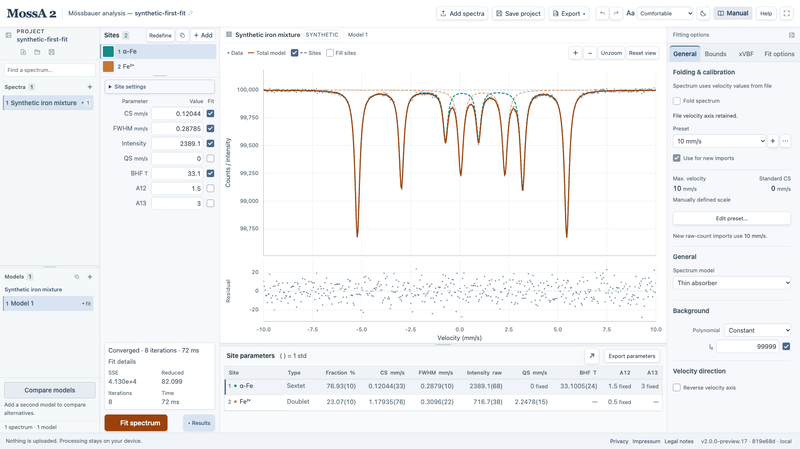

# MossA 2

Mössbauer spectrum analysis in your browser or as an offline desktop app. A React interface and shared Rust fitting core run calculations locally on your device.

**[Open in your browser](https://cprescher.github.io/MossA/)** · **[Desktop downloads](https://github.com/CPrescher/MossA/releases)** · **[User manual](https://cprescher.github.io/MossA/manual/)**

## Capabilities

- Multiple spectra and named model alternatives in one project, with portable `.mossa` files, local autosave, and Undo/Redo.
- Text/CSV, raw-count, single-spectrum SPEC MCA, and five-column SMS imports.
- Spectrum folding, linear or sinusoidal velocity calibration, and velocity-axis reversal.
- Singlets, doublets, and sextets with Lorentzian, Gaussian, pseudo-Voigt, or Lorentzian-squared profiles; polynomial backgrounds.
- Thin-absorber and full-transmission fitting, source-profile calibration, and experimental xVBF CS/QS distributions.
- Bounded fitting with fixed and linked parameters, multistart search, approximate parameter/fraction std, and fit diagnostics.
- Seeded Poisson/Gaussian bootstrap comparisons between nested models, with exportable calculation records.
- SVG, PNG, EPS, and PDF figures; PDF fit reports; spectrum and parameter CSV exports.
- Light/dark themes, adjustable panels, and an illustrated, searchable manual with measured-data tutorials.
- Offline desktop apps for macOS, Windows, and Linux; native Rust desktop jobs and browser WASM workers.

The current source is **2.0.0-rc.1**, a prerelease. See [validation limits and platform qualification](RELEASE-CANDIDATE.md), including experimental models and outstanding Windows/Linux GUI checks. Available downloads may precede this source revision.

[Development](DEVELOPING.md) · [Desktop builds](DESKTOP.md) · [Releases](RELEASING.md) · [Numerical conventions](PORTING.md) · [Original MATLAB application](https://github.com/CPrescher/MossA/tree/matlab-legacy)

MIT licensed. Third-party licenses are listed in [THIRD_PARTY_NOTICES.txt](THIRD_PARTY_NOTICES.txt).
