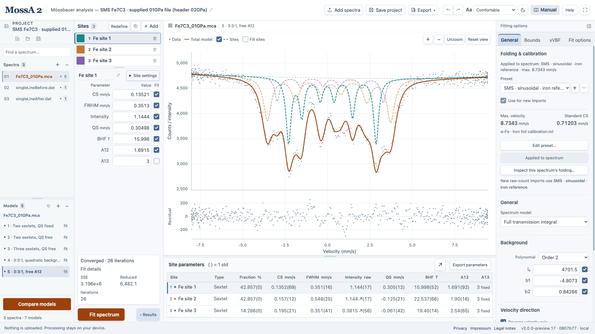

A site is built from individual resonance lines. Its **positions** describe the hyperfine pattern; its **line shape** describes the distribution around each position. Source broadening and absorber saturation are additional parts of the [transmission model](/MossA/manual/foundations/transmission-integral/).

All velocities and widths below use mm/s. Let $x=v-v_0$ be the displacement from a line center and let $w$ denote its width parameter.

## Lorentzian and Gaussian lines

The area-normalized Lorentzian is

$$
L(x;w)=\frac{1}{\pi}\frac{w/2}{x^2+(w/2)^2},\qquad
\int_{-\infty}^{\infty} L(x;w)\,dx=1.
$$

Its FWHM is $w$ and its half-width is $w/2$. Finite lifetime produces a Lorentzian natural line; the observed width can contain other effects. In the thin limit, convolution of two Lorentzians adds their FWHMs. This does not justify adding source width to absorber width inside a saturated exponential transmission model.

An exactly normalized Gaussian with FWHM $w$ is

$$
G(x;w)=\frac{2\sqrt{\ln2}}{w\sqrt\pi}
\exp\!\left[-4\ln2\left(\frac{x}{w}\right)^2\right].
$$

Its std is $w/[2\sqrt{2\ln2}]$. MossA's legacy site-Gaussian expression retains the original MATLAB literals, so its actual implementation is

$$
G_{\mathrm{legacy}}(x;w)=\frac{0.8326}{(w/2)\,1.7725}
\exp\!\left[-\left(\frac{0.8326x}{w/2}\right)^2\right].
$$

Those rounded literals make its area and literal FWHM slightly different from the ideal Gaussian. Gaussian-mixture **source kernels** use the exact normalized Gaussian expression, rather than these legacy site literals.

## Pseudo-Voigt is a sum, not a convolution

MossA's pseudo-Voigt profile is

$$
P(x;w,\alpha)=\alpha L(x;w)+(1-\alpha)G_{\mathrm{legacy}}(x;w),\qquad0\leq\alpha\leq1.
$$

The **L fraction** is $\alpha$: 1 selects Lorentzian and 0 selects Gaussian. A true Voigt profile is a Lorentzian–Gaussian convolution; this weighted sum is an approximation with a different parameterization. Do not equate MossA's mixing fraction to the relative physical contributions of two broadening mechanisms.

## Lorentzian-squared has a legacy width convention

The normalized squared profile is

$$
Q(x;w)=\frac{2}{\pi(w/2)}\left[1+\left(\frac{x}{w/2}\right)^2\right]^{-2}.
$$

Its **actual FWHM** is

$$
w_{1/2}=w\sqrt{\sqrt2-1}\simeq0.64359w.
$$

MossA retains $w$ as the legacy width parameter in both site and simple-source expressions, even where a control is labeled FWHM. For example, a squared-source parameter of 0.436 mm/s corresponds to an actual half-maximum width near 0.281 mm/s. Report the profile and convention together. The source shape can be asymmetric and need not be represented adequately by any single symmetric line.

## Singlet and doublet

Let $F$ stand for the selected unit-area line profile and let $A$ be the raw site intensity parameter. A singlet is

$$
a_{\mathrm{singlet}}(v)=A F(v-\mathrm{CS};w).
$$

For a nonmagnetic doublet, MossA uses

$$
a_{\mathrm{doublet}}(v)=A\left[rF\!\left(v-\mathrm{CS}+\frac{\mathrm{QS}}2;w\right)
+(1-r)F\!\left(v-\mathrm{CS}-\frac{\mathrm{QS}}2;w\right)\right].
$$

Here **A12 is $r$**, the fraction in the lower-velocity line; it is not the ratio of the two line areas. Equal areas mean $r=0.5$. In this model, the two lines share a width.

## Sextet positions and relative strengths

Write $c=\mathrm{CS}$, $q=\mathrm{QS}/2$, $B=\mathrm{BHF}$, and let $k_1,k_2,k_3$ be the versioned outer/middle/inner magnetic coefficients in mm/s/T. MossA's six positions are

$$
\begin{aligned}
v_1&=c-k_1B+q,&v_6&=c+k_1B+q,\\
v_2&=c-k_2B-q,&v_5&=c+k_2B-q,\\
v_3&=c-k_3B-q,&v_4&=c+k_3B-q.
\end{aligned}
$$

This QS is an **approximate magnetic-line shift parameter**; it is not the nonmagnetic doublet separation and does not implement a general combined electric–magnetic Hamiltonian. The average of these six centers is not generally CS when this shift is nonzero.

For sextets, A12 and A13 are line-area ratios $I_1/I_2$ and $I_1/I_3$. Define $r_2=1/\mathrm{A12}$ and $r_3=1/\mathrm{A13}$. The pattern is

$$
1:r_2:r_3:r_3:r_2:1.
$$

The powder setting A12 = 1.5 and A13 = 3 therefore gives $3:2:1:1:2:3$. This meaning of A12 differs from its doublet meaning.

*The field and line ratios control a magnetic pattern. Several fitted components do not, by themselves, establish several distinct phases.*

## Raw intensity, area, and population

The retained sextet expression assigns outer-line area

$$
a_1=\frac{3A}{6+6(r_2+r_3)}.
$$

The six line areas sum to $2a_1(1+r_2+r_3)=A$. Thus changing the line ratios redistributes the site's area while retaining its total intensity parameter, just as the singlet and doublet retain their total $A$ (up to legacy Gaussian rounding). See the exact [core expressions](https://github.com/CPrescher/MossA/blob/main/rust-core/src/lib.rs) and retained [MATLAB sextet](https://github.com/CPrescher/MossA/blob/main/reference/MossA/sextet.m).

The results table reports $100A_j/\sum_k A_k$. For normalized profiles this is the relative fitted count-deficit area in thin mode, or relative integrated optical depth in full transmission. It does not integrate the plotted transmitted-intensity dips, whose areas respond nonlinearly to saturation. The numerical intensity values have different units and meanings in the two modes and must not be transferred unchanged between them.

Even a correctly calculated absorber area is proportional to population only under appropriate assumptions about recoil-free fractions, saturation, texture, and detection geometry. A fixed intensity link fixes its reported ratio by construction. It does not independently measure a site occupancy.

The original program is described by [Prescher, McCammon, and Dubrovinsky (2012)](https://doi.org/10.1107/S0021889812004979). The equations here describe the current browser implementation, whose [validation scope](/MossA/manual/reference/conventions-and-validation/) is narrower than every possible physical model.
