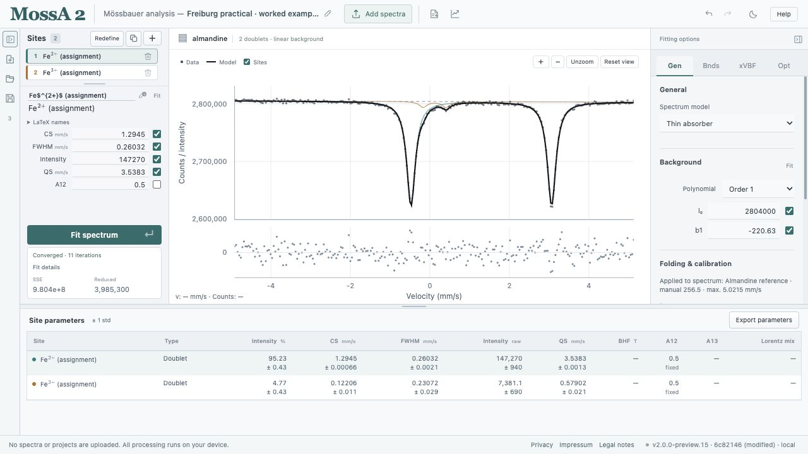

Mössbauer spectroscopy measures resonant nuclear absorption. The positions, widths, and strengths of the absorption lines carry information about the local environment of the resonant nuclei. MossA fits a mathematical description of that spectrum; the mineral, oxidation-state, or magnetic interpretation requires additional evidence.

Read this page for the physical picture, then [line shapes and hyperfine patterns](/MossA/manual/foundations/line-shapes/) for the model parameters and [the transmission integral](/MossA/manual/foundations/transmission-integral/) for the measured count curve.

## Why recoil matters

A free nucleus of mass $M$ recoils when it emits or absorbs a photon of energy $E_\gamma$. In the nonrelativistic limit, the recoil energy is

$$
E_R=\frac{p_\gamma^2}{2M}=\frac{E_\gamma^2}{2Mc^2}.
$$

Emission loses energy to recoil, while absorption requires recoil energy in addition to the nuclear excitation. The mismatch can greatly exceed the natural linewidth. When the nucleus is bound in a solid, a fraction of transitions occur without creating or annihilating a phonon. Momentum is still conserved, but the recoil energy of the whole solid is negligible on the nuclear linewidth scale. This recoil-free fraction enables narrow emission and absorption lines to overlap. See [Mössbauer's Nobel lecture](https://www.nobelprize.org/uploads/2018/06/mossbauer-lecture.pdf) for the discovery and physical argument.

For harmonic motion, the Lamb–Mössbauer factor can be written

$$
f=\exp\!\left[-k^2\langle u_\parallel^2\rangle\right],\qquad k=\frac{E_\gamma}{\hbar c}.
$$

Here $u_\parallel$ is the nuclear displacement along the photon direction, and the brackets denote its mean square. The expression includes zero-point motion. Temperature, bonding, and orientation can change $f$; spectral area therefore does not measure the number of nuclei alone.

## Why the horizontal axis is velocity

The familiar ⁵⁷Fe experiment uses the transition near **14.4 keV**, between an excited state with spin $I_e=3/2$ and a ground state with $I_g=1/2$. A small relative source–absorber velocity changes the photon energy by the first-order Doppler effect:

$$
\Delta E \simeq E_\gamma\frac{v}{c}.
$$

Choose the positive velocity direction consistently with the instrument calibration. Using the transition energy adopted by MossA, $E_\gamma=14.412497\ \mathrm{keV}$, **1 mm/s corresponds to about 48.1 neV**. MossA records the adopted magnetic constants and velocity calibration with the analysis; see [versioned coefficients](/MossA/manual/reference/conventions-and-validation/#versioned-fe-magnetic-coefficients) and [Zhao and Sturhahn (2012), Section 3](https://journals.iucr.org/s/issues/2012/04/00/co5015/).

The lifetime sets the intrinsic energy FWHM:

$$
\Gamma_E=\frac{\hbar}{\tau}=\frac{\hbar\ln2}{t_{1/2}},\qquad
\Gamma_v=\frac{c\Gamma_E}{E_\gamma}.
$$

For the 14.4-keV state, a half-life near 98 ns corresponds to a mean lifetime near 142 ns and a single-transition natural width near **0.097 mm/s**. Half-life and mean lifetime are different quantities. Two natural Lorentzian lines, one source and one absorber, convolve to about twice that width. Instrumental broadening and sample effects can increase the observed width. The spin and lifetime data are tabulated in [NNDC's ⁵⁷Fe evaluation, first page](https://www.nndc.bnl.gov/ensnds/57/Fe/adopted.pdf); that 1998 evaluation is not the source of MossA's newer magnetic-moment convention.

## Center shift: electronic environment and temperature

The electrostatic interaction between the finite nucleus and the electron density at the nucleus shifts the transition energy. Relative to a stated reference, write the isomer shift in velocity units as

$$
\delta_{\mathrm{IS}}=K_{\mathrm{IS}}\,[\rho_a(0)-\rho_{\mathrm{ref}}(0)].
$$

$K_{\mathrm{IS}}$ includes the change in nuclear charge radius and the energy-to-velocity conversion. The observed **center shift, CS**, also includes the relative second-order Doppler shift and any remaining calibration offset. For the vibrational contribution,

$$
\delta_{\mathrm{SOD}}=-\frac{\langle \dot u_a^2\rangle-\langle \dot u_{\mathrm{ref}}^2\rangle}{2c}.
$$

Here $\dot u$ is the nuclear vibrational velocity, distinct from the scanning velocity $v$. The temperature dependence of metallic iron is illustrated experimentally by [Preston, Hanna, and Heberle (1962)](https://doi.org/10.1103/PhysRev.128.2207). State the reference and temperatures when reporting CS. A shift can support an oxidation-state assignment, but it is not a universal one-number oxidation-state test.

## Electric quadrupole interaction: a doublet

An electric field gradient (EFG) interacts with a nuclear quadrupole moment. The ⁵⁷Fe ground state has no quadrupole splitting, while the excited state can split into two pairs of levels. With magnetic interaction absent, the energy separation is

$$
\Delta E_Q=\frac{|eQV_{zz}|}{2}\sqrt{1+\frac{\eta^2}{3}},\qquad
\eta=\frac{V_{xx}-V_{yy}}{V_{zz}},\qquad 0\leq\eta\leq1.
$$

$Q$ is the excited-state quadrupole moment, $e$ the elementary charge, and $V_{ii}$ the EFG principal components, ordered so that $|V_{zz}|\geq|V_{yy}|\geq|V_{xx}|$. Convert to velocity with $\Delta v_Q=c\Delta E_Q/E_\gamma$ using consistent units. In MossA's nonmagnetic doublet, **QS is the full separation**, so the line centers are $\mathrm{CS}\pm\mathrm{QS}/2$. An ordinary unoriented doublet generally does not establish the sign of $V_{zz}$.

*Measured teaching example. Two fitted doublets are spectral components; assigning them to particular iron environments is a separate interpretation.*

## Magnetic interaction: six allowed transitions

For a simple magnetic dipole interaction,

$$
E(I,m)=-g_I\mu_N mB_{\mathrm{hf}}.
$$

$g_I$ is the nuclear $g$ factor, $\mu_N$ the nuclear magneton, and $B_{\mathrm{hf}}$ the local hyperfine field. The magnetic-dipole selection rules $\Delta m=0,\pm1$ give six transitions between the split $I_e=3/2$ and $I_g=1/2$ levels. The outer, middle, and inner line-pair separations scale with the field. **BHF measures a local nuclear field**, not directly the sample's macroscopic magnetization.

For an isotropic random powder with equal sublevel populations and the usual unpolarized-beam assumptions, line areas follow $3:2:1:1:2:3$. Texture, polarization, and dynamics can change intensities or invalidate a static sextet description. Comparable magnetic and quadrupole interactions can require a combined Hamiltonian, rather than the approximate sextet shifts supplied by MossA. [Yaroslavtsev (2023), Section 3](https://journals.iucr.org/s/issues/2023/03/00/gy5045/) discusses these distinctions.

## What a fit can establish

Use line positions, residuals, widths, intensity ratios, and independent sample information together. A broad line can represent unresolved sites, a distribution, relaxation, instrumental broadening, or inadequate calibration. A missing sextet can reflect fast magnetic relaxation rather than the absence of magnetic atoms. A better numerical fit alone does not select a unique physical explanation.

Continue with [the model equations](/MossA/manual/foundations/line-shapes/) or apply the ideas in the [almandine](/MossA/manual/tutorials/almandine/) and [SYNCmoss standard](/MossA/manual/tutorials/syncmoss/) tutorials.
