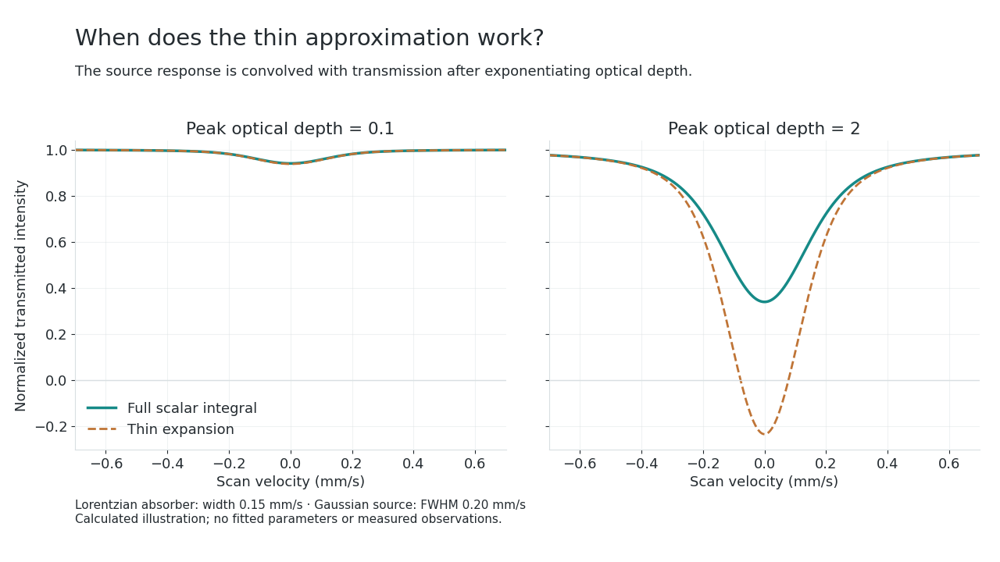
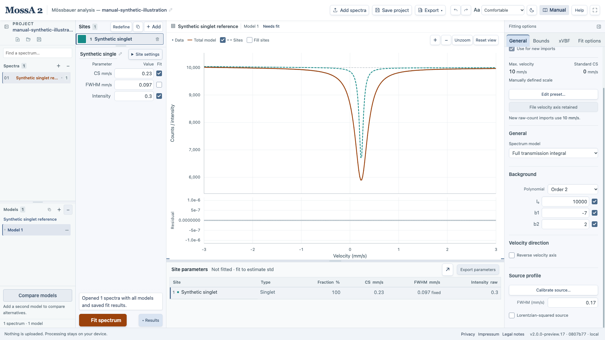

A measured spectrum is a source-broadened **transmitted intensity**. An absorber line describes the probability of absorption at each energy; a source profile describes the distribution of incident photon energies. In a thick absorber, exponentiation and source convolution must occur in the correct order.

## Start with optical depth

For a homogeneous, scalar absorber, let

$$
\tau(u)=\sum_j\tau_j(u),\qquad T_a(u)=e^{-\tau(u)}.
$$

$u$ is an absorber velocity-equivalent energy coordinate, $\tau$ is dimensionless resonant optical depth, and $T_a$ is the absorber transmission. For independent, homogeneously mixed components, optical depths add **inside** the exponential. A physical effective thickness is often written $t_j=N_j f_j\sigma_0$, with resonant areal density $N_j$, absorber recoil-free fraction $f_j$, and a specified resonant cross-section convention $\sigma_0$. Then $\tau_j=t_j\phi_j$ when $\phi_j$ is a dimensionless cross-section shape. See [Yaroslavtsev (2023), Section 3 and equation 1](https://journals.iucr.org/s/issues/2023/03/00/gy5045/) for its thickness definition.

MossA instead constructs $\tau$ from its raw site intensity parameters and the [line-profile expressions](/MossA/manual/foundations/line-shapes/). An area-normalized profile has units of inverse velocity, so its optical-depth coefficient has units of velocity. It is not numerically identical to a dimensionless effective thickness from another package.

## Convolve transmission with the source response

Let $R$ be the velocity-response kernel, normalized so that $\int R(s)\,ds=1$. MossA's convolution convention is

$$
\boxed{\mathcal T(v)=\int_{-\infty}^{\infty}R(v-u)\exp\!\left[-\sum_j\tau_j(u)\right]du.}
$$

The scan velocity is $v$. With an incident resonant continuum $C_r$ and an unabsorbed contribution $C_{\mathrm{nr}}$, an idealized count model is $C(v)=C_{\mathrm{nr}}+C_r\mathcal T(v)$. Electronic attenuation, detector background, photons outside the resonant source fraction, and acquisition time determine those count scales. If the source recoil-free fraction is represented explicitly, one common physical form is

$$
C(v)=C_{\mathrm{bg}}+C_{\mathrm{off}}\left[(1-f_s)+f_s\mathcal T(v)\right].
$$

This last expression is a general physical description. MossA does **not** independently fit all of $C_{\mathrm{bg}}$, $C_{\mathrm{off}}$, and $f_s$. Do not read those physical parameters directly from its background coefficient.

For asymmetric sources, the definition of the response direction matters. A package that uses a source-energy distribution with $T_a(v+u)$ needs a reflected response in an $R(v-u)T_a(u)$ convention. The [SYNCmoss tutorial](/MossA/manual/tutorials/syncmoss/) gives an explicit conversion and retains the original source parameters.

## Why the thin limit becomes additive

When $\tau(u)\ll1$ over the relevant absorber energies,

$$
e^{-\tau}\simeq1-\tau,\qquad
\mathcal T(v)\simeq1-\sum_j\int R(v-u)\tau_j(u)\,du.
$$

The count deficit is then approximately a sum of source-broadened absorber profiles. At larger optical depth, strong lines saturate, broaden, and grow less than linearly with resonant areal density. Small observed depth alone does not establish the thin limit: background dilution and source broadening can make a saturated absorber look shallow.

*Calculated teaching figure, not measured data. Both panels use the same Lorentzian absorber width and Gaussian source width; only peak optical depth changes. The thin curve is the first-order expansion of the same integral, without refitting.*

In **Thin absorber** mode, MossA directly fits

$$
C_{\mathrm{thin}}(v)=B(v)-\sum_j a_j(v).
$$

Here $B(v)$ is the selected polynomial background and $a_j$ is the fitted site profile in count units. There is no separate source convolution in this mode: its fitted widths are empirical observed-profile parameters. Switching to full transmission requires physically appropriate absorber widths, source settings, and intensity starts.

## MossA's full-transmission count model

For background $B(v)=b_0+b_1v+b_2v^2+\cdots$, the implemented ordinary-sample model is

$$
\boxed{C_{\mathrm{MossA}}(v)=b_0\mathcal T(v)+B(v)-b_0.}
$$

With a constant background this reduces to $b_0\mathcal T(v)$. Higher polynomial terms are additive baseline corrections; the code does not multiply the whole polynomial by transmission. Keep that distinction when comparing another program's baseline or physical continuum model.

Under **General → Spectrum model**, select **Full transmission integral**. Set the source response separately from the absorber site width. In a Gaussian-mixture source,

$$
R(s)=\sum_k p_kG(s-\bar\mu_k;w_k),\qquad
\sum_kp_k=1,\qquad\sum_kp_k\bar\mu_k=0.
$$

MossA normalizes the positive component weights and removes their weighted centroid. The full shape is then held fixed in sample fits. A squared-source width follows the legacy parameter convention described under [line shapes](/MossA/manual/foundations/line-shapes/#lorentzian-squared-has-a-legacy-width-convention).

*Generated illustration. A source response and an intrinsic absorber width are separate inputs. This is not measured validation of a particular instrumental function.*

Colored site overlays are scaled absorber profiles. Since $e^{-\sum_j\tau_j}\neq1-\sum_j(1-e^{-\tau_j})$, they are not independent transmitted components and do not add to the fitted total.

## Numerical implementation and limits

The current core evaluates absorber optical depth on **−30 to +30 mm/s at 0.01 mm/s spacing**, performs zero-padded FFT convolution, and samples the result at the observation velocities. Legacy Lorentzian and squared sources retain PCHIP interpolation and finite-grid truncation without renormalizing their tails. Gaussian mixtures are normalized on the grid, convolve the absorption deficit $e^{-\tau}-1$ to preserve the continuum under padding, and use six-point local interpolation. The ideal infinite-domain equations above and the finite numerical calculation are therefore distinct.

The dedicated singlet source-calibration routine also divides its sampled transmission by the maximum sampled value; ordinary sample fitting does not. A source-reference intensity/background should not be transferred to a sample as a physical sample parameter. The [implementation and comparison record](https://github.com/CPrescher/MossA/blob/main/validation-data/syncmoss-sms/README.md) documents the tested numerical cases.

“Full transmission” here means saturation plus source convolution for the supported **scalar absorber model**. It does not add a general polarization-matrix calculation, texture model, relaxation dynamics, coherent multilayer propagation, or arbitrary combined hyperfine Hamiltonian. Those effects can matter especially for polarized SMS measurements. Lateral sample heterogeneity can require averaging different transmitted intensities, rather than exponentiating one averaged optical depth.

## Fit quality and uncertainty

For counts $y_i$ and calculated counts $C_i$, unweighted fitting minimizes $\sum_i(y_i-C_i)^2$. The **1 / observed counts** option minimizes

$$
Q=\sum_i\frac{(y_i-C_i)^2}{y_i},\qquad
Q_{\mathrm{red}}=\frac{Q}{N-p}.
$$

$N$ is the number of observations and $p$ the number of independent varying parameters after links and fixed values. Count weighting requires positive observations; MossA rejects nonpositive counts in that mode. This observed-count weighted least-squares objective is **not an exact Poisson maximum-likelihood fit**. A value near one is meaningful only when the counting-noise assumptions and model are appropriate; it does not certify a unique physical interpretation. The reported local 1 std does not include fixed-source, calibration, nuclear-constant, or model-choice uncertainty. See [reading results](/MossA/manual/guides/reading-results/).
