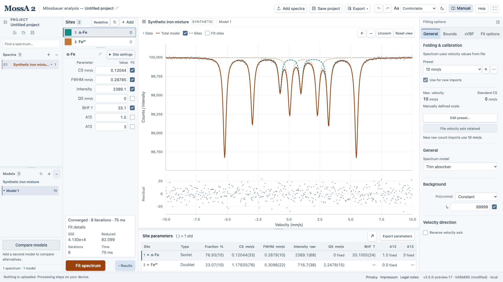

This tutorial takes you through a complete analysis using the built-in **Synthetic iron mixture**. It has a sextet and a doublet with deliberately imperfect starting parameters.

If you are new to the interface, begin with [the workspace tour](/MossA/manual/getting-started/workspace/), which explains the sections and their locations on desktops, laptops, and tablets. This synthetic example already has a velocity axis. For your own raw data, first open **Fitting options → General → Folding & calibration** and follow [folding and velocity calibration](/MossA/manual/guides/folding-and-calibration/).

:::note[Teaching data]
The example is generated deterministically in the app. It is not a measured iron standard. Its noise is simulated Gaussian noise, so it is also unsuitable for a Poisson-count simulation test.
:::

## 1. Open the example

1. [Open MossA](https://cprescher.github.io/MossA/).
2. If you have an existing analysis, use **Save project** before proceeding.
3. A fresh browser session starts with the synthetic mixture. If you see your previous work instead, [download the synthetic starting project](/MossA/manual/tutorial-data/synthetic-first-fit.mossa) and use **Open project**. Opening replaces the current project, so save your existing work first.
4. Select the example in the spectrum list if necessary.

The spectrum and residuals occupy the graph area. On a wide screen, Sites is on the left and Fitting options is on the right. In narrower windows, switch between Sites and Fitting options above the shared editor; tablets also provide a Spectrum view. **Results**, beside Fit spectrum, shows the table below the graph. The project sidebar starts collapsed in a fresh session.

## 2. Inspect the starting model

The example starts in **Thin absorber** mode with a constant background. Its two sites are labeled **α-Fe** and **Fe²⁺**. These labels identify the intended teaching components; the app does not infer chemical identities from their names.

Select each site and inspect its CS, FWHM, intensity, and splitting parameters. The sextet also has a magnetic hyperfine field, BHF. A checked parameter varies during refinement. The sextet's QS and the line-intensity ratios are held fixed in this example.

In **Fitting options → Fit options**, keep **Residual weighting → Unweighted** and **Starting models → 1 · Current model** for this first fit.

## 3. Fit the spectrum

Choose **Fit spectrum**. The app refines the varying parameters and updates the graph and Status panel. A short fit may finish before you see an intermediate iteration.

Wait for the fit to finish. Read its termination status and warnings. Reaching the iteration limit is different from convergence. **Stop & keep** stops early and keeps the latest displayed parameter values. These values can be saved, undone, or used as the starting point for another fit; std is unavailable until a fit completes. **Cancel fit** discards the running fit and restores its starting model and any previous fit results.

*The completed example in a local browser build. Elapsed time depends on the device and is not a benchmark.*

## 4. Inspect the result

Check three things together:

- **The total curve:** does it follow the observations over the entire velocity range?
- **The residuals:** do the observed-minus-model differences have structure, especially near the absorption lines?
- **The parameters:** are the widths, shifts, splitting, and field plausible, and are any parameters at a bound?

For this constructed example, the fit should approach the input values below. Small differences arise from the simulated noise; these are generation values, not independently measured reference values.

| Component | Generation values |
| --- | --- |
| Sextet | CS = 0.12 mm/s; BHF = 33.1 T; FWHM = 0.29 mm/s; raw intensity = 2,400 |
| Doublet | CS = 1.18 mm/s; QS = 2.25 mm/s; FWHM = 0.31 mm/s; raw intensity = 720 |
| Background | Constant = 100,000 |

The result table reports approximate **1 std** in parentheses where an uncertainty is available. **Fixed** indicates a held parameter. **(—)** means the app cannot report a symmetric uncertainty; hover over the entry for the reason.

## 5. Try an alternative without losing the fit

Expand the project sidebar, right-click the current model, and choose **Duplicate model**. Rename the copy to describe your test. Change a starting width or shift in the copy, then fit again.

Switch between the models to inspect their saved fits. Duplication retains the original fit and gives the copy independent model settings. Selecting a model does not run an optimization.

## 6. Save and export

1. Use **Save project** to download a `.mossa` file containing all spectra, models, and completed fits.
2. Use **Export parameters** above the results table to save parameter values and uncertainties as CSV.
3. Use **Export → Figure (SVG/PNG/EPS/PDF)** in the top toolbar to prepare a figure.

Browser autosave helps you resume on the same browser and app address. Keep the downloaded project as your portable analysis record.

Next, [import your own spectrum](/MossA/manual/guides/importing-data/) or learn how to [build a model](/MossA/manual/guides/building-models/).

## Keep the analysis in view

The plot, residuals, Fit status, and site results form the main analysis overview. On smaller screens, Sites and Fitting options share the inspector; a portrait tablet has separate Spectrum, Sites, and Fitting options views. **Results**, beside Fit spectrum, opens values and approximate 1 std. Hiding the table removes its whole strip. Cursor velocity and counts appear inside the plot only while pointing at the data. That view stays open for subsequent fits until you hide it. Selecting a results row opens that site for editing.

Use **⌘/Ctrl+Enter** to fit the current model without moving from the parameter editor. Pending numeric input is committed and validated first. Existing models can be duplicated and applied to further spectra; switching between saved models preserves their completed fits. Review each spectrum’s residuals and warnings rather than assuming that the same model fits every spectrum.
