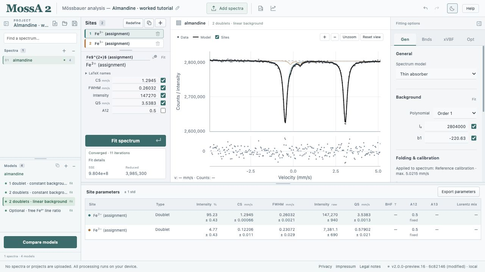

The workspace keeps observations, model controls, and results visible together. Panels can be resized or collapsed to give the graph more room.

*Read from left to right: project and model selection, site controls, spectrum/residuals, and fitting options. The parameter table spans the area below. This is the measured Freiburg worked example.*

## Find the controls

| Area | Purpose |
| --- | --- |
| Top toolbar | Create, open, and save projects; import spectra; undo and redo; export data and figures; open Help |
| Project sidebar, far left | Select spectra and alternative models; add, duplicate, rename, and remove them |
| Site panel, left of the graph | Select and edit sites, define peaks on the graph, start a fit, and read Status |
| Center | Inspect observations, the total model, site curves, and residuals |
| Fitting options, right | **Gen**: model mode, background, calibration, source. **Bnds**: bounds and links. **xVBF**: distributions. **Opt**: solver settings |
| Results table, below | Inspect site parameters, intensity percentages, and approximate uncertainties; export parameters |
| Footer | Running version, update status, privacy, publisher information, and legal notes |

Use the sidebar icons to show or collapse the project browser and fitting options. Drag the divider between spectra and models, below the site list, or above the results table to allocate space. Panel layout is retained in local autosave.

## Work with several spectra and models

**Add spectra** imports files without replacing your current project. Each spectrum has its own models. Use the search box to find a spectrum, then select a model beneath it.

Double-click a spectrum or model name to rename it. Enter or clicking away saves; Escape cancels. Click the project name to rename the project. Renaming preserves completed fits.

The + and − controls act on the corresponding spectrum or model list. A new model starts without sites; **Duplicate model** copies the selected model, including its current fit. Right-click a model row to duplicate, rename, or remove that model, including an inactive one. Shift+F10 opens the same menu from the keyboard.

Counts and the velocity axis belong to the spectrum. Folding or calibration changes therefore affect **all models of that spectrum** and invalidate obsolete fits. Site, background, and source edits belong to the selected model.

**Compare models** is below the model list in the expanded project sidebar.

## Navigate the graph

| Gesture | Action |
| --- | --- |
| Left drag | Rectangle zoom |
| Right drag | Pan in velocity and intensity |
| Right click | Return to the previous view |
| Double right click | Reset the view |
| Mouse wheel | Zoom velocity around the pointer, retaining vertical limits |

These gestures remain available while defining a site. An undragged left click places a definition point. Selecting a site in the site list or results table brings its thicker curve to the foreground.

## Edit values and undo changes

Numeric fields normally show up to five significant digits. Focus a field to see the full stored value. Leaving a value unchanged does not round it. Enter commits an edit and Escape cancels it.

Undo and Redo retain up to 50 committed changes, including imports, model edits, and completed fits. Outside editable fields, use ⌘/Ctrl+Z to undo and ⌘/Ctrl+Shift+Z to redo; Ctrl+Y also redoes. Inside an input, native text undo applies.

Plot navigation and selection do not consume undo steps. Undo history starts fresh after a reload and is not included in downloaded project files.
