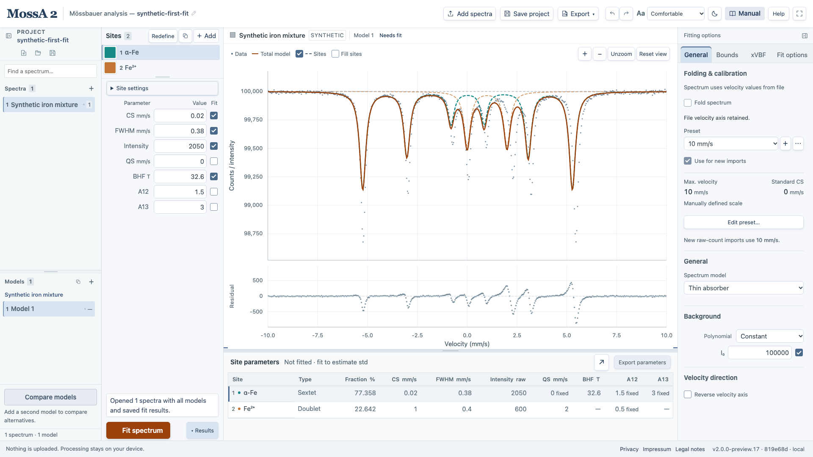
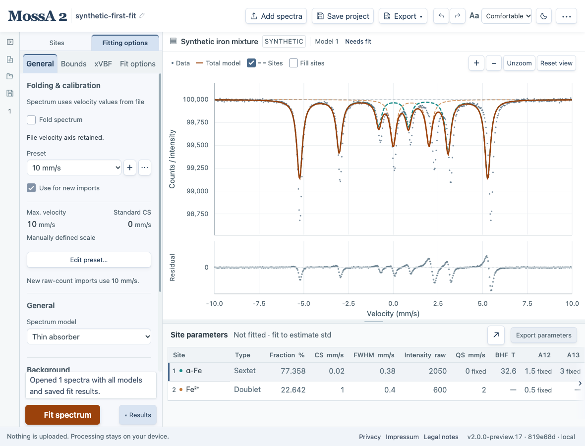
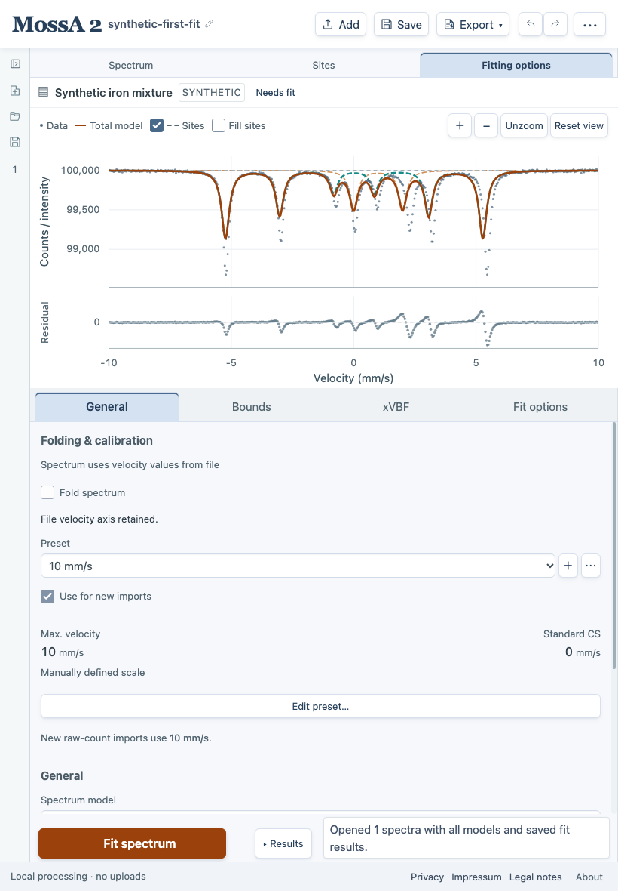

Start by locating **Fitting options → General → Folding & calibration**. This is where you prepare raw channels and create or apply a velocity calibration. It appears first in General, before Spectrum model and Background. On a laptop or tablet, select **Fitting options** above the editor; on a wide screen, look in the right panel.

The workspace has four main tasks: choose a spectrum and model, prepare the measurement, edit the model's sites, and inspect the fit. Their controls move with the available space. Changing the layout keeps the same spectrum, model, and parameters.

*Wide layout with the built-in synthetic mixture and the project sidebar expanded. This example already has a velocity axis; use a raw-count file for folding and velocity calibration.*

## Find the controls

| Area | Purpose |
| --- | --- |
| Top toolbar | **Add spectra**, **Save project**, **Export**, Undo/Redo, and display/help controls. **Manual** and **Help** are inline on wide screens and in the three-dot menu on smaller screens |
| Project sidebar, far left | Create/open projects; select spectra and alternative models; add, duplicate, rename, and remove them. Expand it with **Expand project sidebar** |
| Sites editor | Select and edit sites, choose type and profile in **Site settings**, or define peaks on the graph |
| Center | Inspect observations, the total model, site curves, and residuals |
| Fitting options | **General**, **Bounds**, **xVBF**, and **Fit options**, described below. This is a right panel on wide screens and shares the editor on smaller screens |
| Fit controls | **Fit spectrum**, **Results**, and fit status, beneath the editor. Warning counts open diagnostics; **Fit details** shows iteration and objective information, automatically when space permits or on opening its disclosure |
| Results, below the graph | Toggle with **Results** beside Fit spectrum. Inspect site parameters, fractions, and approximate 1 std; export parameters or expand the table |
| Footer | Running version, update status, privacy, publisher information, and legal notes |

Use the sidebar icons to show or collapse the project browser and fitting options. Drag the divider between spectra and models, below the site list, or above the results table to allocate space. Panel layout is retained in local autosave.

## Locate controls in your layout

| Layout | Where to work | Where to calibrate |
| --- | --- | --- |
| Wide desktop | Sites on the left, graph in the center, Fitting options on the right; project navigation can be expanded at the far left | Right panel → **General → Folding & calibration**. Use **Show fitting options** if collapsed |
| Laptop or narrower desktop window | **Sites** and **Fitting options** share the left editor; the graph stays beside it | Select **Fitting options → General → Folding & calibration** |
| Tablet or narrow window | Use **Spectrum**, **Sites**, and **Fitting options** above the content to choose a view | Select **Fitting options → General → Folding & calibration** |

*Laptop layout with Fitting options selected. Calibration has the same location within General as on a wide desktop. Opening the project sidebar or increasing interface text size can make the app switch to this shared editor sooner.*

*A tall portrait tablet keeps a live graph above Sites or Fitting options. Shorter windows show one view at a time. Select Spectrum to give the graph more space and access Results.*

The project browser starts collapsed in a fresh session. On tablets it opens over the workspace; collapse it again to reach the full editing area. Panels scroll independently, so scroll within Fitting options to reach controls farther down General.

## What is in Fitting options?

| Tab | Controls and purpose |
| --- | --- |
| **General** | **Folding & calibration** first: presets, velocity-reference calibration, and inspection of a raw sample with folding enabled. Then **Spectrum model**, **Background**, **Velocity direction**, and, for full transmission, **Source profile** |
| **Bounds** | Limits and proportional links for the selected site's parameters. Use its **Site** selector to change the site being edited |
| **xVBF** | CS/QS distributions and their correlation for a distribution model. This changes the selected site's model; see [xVBF distributions](/MossA/manual/guides/xvbf/) |
| **Fit options** | Numerical refinement settings, including **Residual weighting**, **Starting models**, and iteration limits |

**Fitting options** names the whole panel; **Fit options** is its solver tab. To calibrate the velocity axis, open **General**. To determine the source shape for a full-transmission fit, use **General → Source profile → Calibrate source…**. These calibrations determine different quantities.

For a first measured spectrum, [check folding and calibrate velocity](/MossA/manual/guides/folding-and-calibration/) before adjusting site parameters. The built-in synthetic example and imported two-column velocity/count files already supply a velocity axis.

## Understand the analysis modes

Under **General → Spectrum model**, choose the physical model:

- **Thin absorber** uses a background minus absorption profiles. Each site has its own line profile and parameters.
- **Full transmission integral** includes source convolution and a nonlinear absorber response. It makes **Source profile** available farther down General; scroll within the panel to reach it.

Switching mode changes the intensity convention, rescales existing intensities as starting estimates, and requires a new fit. It does not fold or calibrate the data. See [building models](/MossA/manual/guides/building-models/) and [source profiles](/MossA/manual/guides/source-profiles/) before interpreting the parameters.

An **xVBF** distribution is a site-model choice edited in its own tab. **Spectrum**, **Sites**, and **Fitting options** on a tablet are views of the same analysis. Light/dark theme, text size, and panel visibility change its presentation.

## Work with several spectra and models

**Add spectra** imports files without replacing your current project. Each spectrum has its own models. Use the search box to find a spectrum, then select a model beneath it.

Double-click a spectrum or model name to rename it. Enter or clicking away saves; Escape cancels. Click the project name to rename the project. Renaming preserves completed fits.

The + controls add spectra or create a new model in the corresponding list. Point at a row or focus it to reveal its pencil and trash icons for renaming and deleting that item; Undo restores a deletion. A new model starts without sites; **Duplicate model** copies the selected model, including its current fit. Right-click a model row to duplicate, rename, or remove that model, including an inactive one. Shift+F10 opens the same menu from the keyboard.

Counts and the velocity axis belong to the spectrum. Folding or calibration changes therefore affect **all models of that spectrum** and invalidate obsolete fits. Site, background, and source edits belong to the selected model.

**Compare models** is below the model list in the expanded project sidebar.

## Navigate the graph

| Gesture | Action |
| --- | --- |
| Left drag | Rectangle zoom |
| Ctrl/Command + left drag, or right drag | Pan in velocity and intensity |
| One-finger touch drag | Pan; use +/− to zoom |
| Right click | Return to the previous view |
| Double right click | Reset the view |
| Mouse wheel | Zoom velocity around the pointer, retaining vertical limits |

While defining a site, an undragged click or tap places a point. Left drag, including Ctrl/Command + left drag or touch drag, instead zooms; right drag still pans. Cancel placement to return to normal touch panning. The plot buttons **Zoom in**, **Zoom out**, **Unzoom**, and **Reset view** are also available. Selecting a site emphasizes its outline. Dashed site curves remain distinct from the solid total model even when their colors are similar. Small solid data dots sit above the site curves. The orange total-model line is drawn last, so neither a selected component nor overlapping data markers can obscure it. The lower panel is labeled Residual.

## Edit values and undo changes

Numeric fields show up to five significant digits and keep the same text when focused. Hover to inspect the full stored value. Leaving a value unchanged, or re-entering its displayed text, does not round the stored value. An explicit edit can contain additional digits; these are retained internally. Enter commits an edit and keeps focus in the field. Shift+Enter commits and moves to the next numeric field, skipping Fit checkboxes. Escape cancels the edit and keeps focus. ⌘/Ctrl+Enter commits and fits the model.

Undo and Redo retain up to 50 committed changes, including imports, model edits, and completed fits. Outside editable fields, use ⌘/Ctrl+Z to undo and ⌘/Ctrl+Shift+Z to redo; Ctrl+Y also redoes. Inside an input, native text undo applies.

Plot navigation and selection do not consume undo steps. Undo history starts fresh after a reload and is not included in downloaded project files.

**Fill sites** beside **Sites** shades each profile to the evaluated background, like the figure preview. It starts off and changes only the display; observations, parameters, fits, and exports are unchanged. Hiding Sites also hides the fills. In full-transmission mode, these remain display-scaled absorber profiles, not additive transmission components.

Results is docked under the graph so that opening it keeps the parameter inspector at full height. Drag its divider to adjust the space, or choose **Expand results** for a full-width table; Escape returns to the workspace. On a laptop, the **Site** selector in Bounds and xVBF identifies the site being edited and lets you switch it directly.

Numeric inputs accept signed values and scientific notation. Touch devices receive the full text keyboard so minus signs and `e` remain reachable. Physical tablet behavior still depends on the device and browser.

## Readable controls on smaller screens

**Save project** and **Export** stay visible in the header; narrow windows shorten Save project to **Save** and Add spectra to **Add**. Save project keeps the complete editable MossA workspace. Export groups **Spectrum data (CSV)**, **Parameter table (CSV)**, **Figure (SVG/PNG/EPS/PDF)**, and **Fit report (PDF)** for use outside MossA. The panel identifies the current spectrum and model. Parameter tables require a current fit. Text size and theme remain inline where they fit; smaller screens group them with Manual and Help under the three-dot control. The three-dot control is named **Manual and help** or **Display and help**, depending on the available space. Arrow Down enters a menu, and Escape closes it.

Site names appear in the list; double-click a name or use its pencil icon to rename it inline. **Site settings** is the disclosure above the numeric parameters. When the full site list would hide primary parameter fields, a compact Site selector is used. The numbered count button can restore the full list. This changes the view, not the model. CS, FWHM, Intensity, QS, and BHF appear before the intensity ratios throughout the editor and tables.

On a tall portrait tablet, selecting Sites or Fitting options keeps the live spectrum above the editor. Editing a value updates that visible graph. Select Spectrum for a larger plot and Results. Shorter screens retain separate views. The compact footer's About control opens full version and change information.

If a fit has warnings, the status displays their count directly. Select the count or the warning note above Results to read the full diagnostic text in one action. Iterations, timing, objective, and multistart information remain in Fit details. Convergence does not remove fit warnings.

Numeric entry accepts a decimal point, unambiguous decimal commas (1,5 or 0,25), and the Unicode minus sign (−), including exponents. A value such as 1,234 could be a decimal or a thousands group, so the app asks you to write 1.234 or 1234 explicitly. Do not enter thousands separators. Displayed values use a decimal point. Re-entering the compact display with a decimal comma preserves the original stored precision too. Invalid text is retained for correction; Escape restores the preceding value.

The mouse-coordinate box keeps its corner while you inspect the graph. Crossing the middle no longer moves it. It moves away only after the pointer remains over the box briefly, then holds its new position; the coordinate values continue updating immediately.
