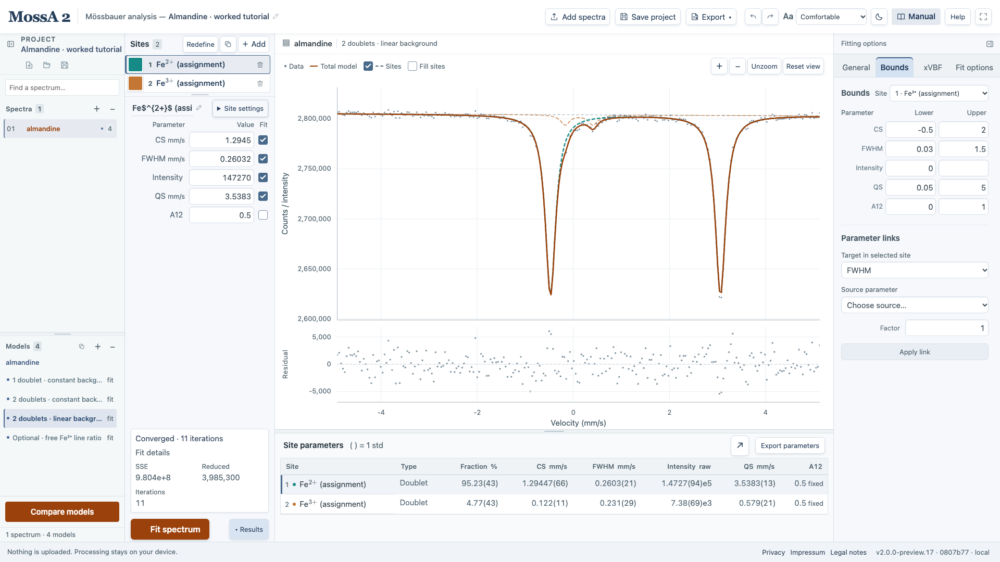
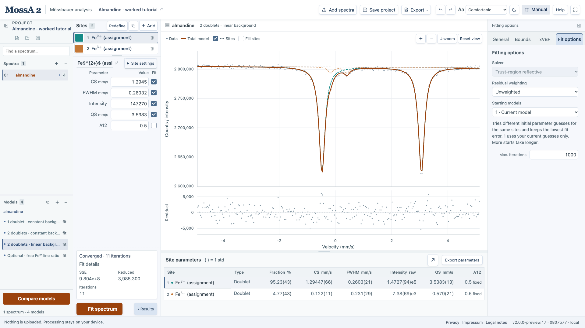

Start with a model that expresses a plausible interpretation of the spectrum. Additional sites and free parameters should answer a specific question about unresolved structure or a physical hypothesis.

For raw data, first check **Fitting options → General → Folding & calibration**. Preparing the velocity axis and folding precedes choosing the sample model. See [folding and velocity calibration](/MossA/manual/guides/folding-and-calibration/). On smaller screens, choose **Fitting options** above the editor to reach General.

## Choose the spectrum model

Under **General → Spectrum model**, choose:

- **Thin absorber:** a polynomial background minus the sum of absorption profiles.
- **Full transmission integral:** a source-convolved transmission model with a nonlinear absorber response.

The modes use different raw intensity units. Switching mode rescales current intensities as approximate starting estimates and requires a new fit. Full-transmission source settings are described in [source profiles](/MossA/manual/guides/source-profiles/).

Under **General → Background**, select a constant or polynomial of order 1–3. Checked background coefficients vary during fitting. A background-only model with no sites can also be evaluated and fitted.

## Add a site on the graph

1. Choose **＋ Add** in **Sites** to open **New site**.
2. Choose **Site type** and **Line profile** in the two dropdowns, then choose **Define on graph**.
3. Click the first line's position and depth.
4. Click to set its half-width.
5. For a doublet, click the other line. For a sextet, click the opposite outer line.

The moving preview helps you estimate the starting values. Escape or **Cancel** leaves the model unchanged. While placing points, left drag zooms and right drag pans; an undragged click places a point. See [graph navigation](/MossA/manual/getting-started/workspace/#navigate-the-graph) for touch behavior.

To create a site without clicking the graph, choose **Add with starting values** in New site, then edit its parameters.

**Redefine** repeats this workflow for the selected site while retaining its name, profile, fit flags, bounds, and links. Linked parameters continue following their sources; inconsistent bounds are rejected.

Available site types are **Singlet**, **Doublet**, and **Sextet**. Profiles are **Lorentzian**, **Gaussian**, **PseudoVoigt**, and **LorSquared**. Open **Site settings** to inspect type and profile settings. The **Duplicate site** icon beside Redefine copies the selected site. The app supports up to 16 sites. When space permits, up to four sites appear in a vertical list with a draggable divider below it. Longer lists or limited editor height use a compact **Site** selector; the numbered count button restores the full list. The larger color swatch opens a color picker. Site colors are saved with the project and retained through fitting, and appear in the spectrum, results, and initial figure-export settings. Color changes preserve completed fit results.

## Understand the parameters

| Parameter | Meaning in the app |
| --- | --- |
| CS | Center shift, in mm/s, on the supplied or calibrated velocity axis |
| FWHM | Line-width parameter, in mm/s; profile-specific conventions matter |
| Intensity | Raw site area/intensity parameter; units depend on spectrum mode |
| QS | Quadrupole parameter, in mm/s; doublet centers are CS ± QS/2 |
| BHF | Magnetic hyperfine field in T for a sextet |
| A12, doublet | First-line area fraction between 0 and 1; 0.5 gives equal areas |
| A12, A13, sextet | First-to-second and first-to-third line-area ratios |
| L fraction | Lorentzian mixing fraction of a pseudo-Voigt profile, between 0 and 1 |

For a magnetic sextet, QS enters the retained magnetic-line shift convention; it should not be interpreted using the nonmagnetic doublet formula. Distribution widths and Lorentzian-squared widths also need their specific conventions. See [the numerical reference](/MossA/manual/reference/conventions-and-validation/).

## Site names and mathematical notation

Site names are labels; they do not change the fit or assign a chemical species. Select a site using its visible name button (arrow keys also switch sites), then edit **Site name** above its parameters. Press Enter or click away to apply; Escape cancels the edit. Press Delete while a site button is focused to remove that site; Undo restores it.

Use `$…$` for mathematical notation inside a name. For example:

| Enter | Display |
| --- | --- |
| `Fe$^{2+}$` | Fe²⁺ |
| `Fe$^{3+}$` | Fe³⁺ |
| `$\alpha$-Fe` | α-Fe |
| `High-spin Fe$^{2+}$` | High-spin Fe²⁺ |
| `$d_{x^2-y^2}$` | A mathematical orbital label |

Supported commands and braced scripts can also be entered directly. Names render in the site buttons, results, and exported figures; the name field retains the editable source notation. Invalid notation shows an explanation and falls back to literal text. Plain text and Unicode names such as `α-Fe` also work. Project files and parameter CSV exports retain the original name source.

## Fix, bound, or link a parameter

A checked fit box lets a parameter vary. Uncheck it to hold the value fixed. In **Fitting options → Bounds**, select the intended **Site** and enter lower and upper limits; an empty bound means no user limit, subject to the model's physical restrictions.

For a proportional link, choose **Target in selected site**, **Source parameter**, and **Factor**, then choose **Apply link**:

$$
p_{\mathrm{target}} = f\,p_{\mathrm{source}}.
$$

The target follows its source instead of being optimized independently. Target bounds also constrain the source. Cycles, missing sources, or inconsistent bounds are invalid.

*Select the intended site first. A link is entered as target = factor × source; entering ordinary bounds does not create a link.*

## Choose fitting options

Under **Fitting options → Fit options**, set **Derivatives**, **Residual weighting**, **Starting models**, and **Max. iterations**.

Thin models use **Thin fitting → Variable projection** by default when analytical derivatives are selected. It solves fitted intensities and background coefficients as a bounded linear problem while refining the remaining parameters. Fixed parameters and proportional links retain their meanings, and std still uses the full Jacobian, including correlations with intensity and background. Select **Thin fitting → Joint fitting** to use the joint solver; compare both for difficult starting models. Saved joint selections are retained. Projects with no saved thin-solver selection use variable projection. Rank-deficient linear systems use joint fitting.

**Derivatives → Analytical** is the default for ordinary thin and transmission singlets, doublets, and sextets with any supported line shape, including parameter links and count weighting. The same analytical Jacobian is used for fitting and parameter std. Transmission supports fixed Lorentzian, Lorentzian-squared, and Gaussian-mixture sources. Analytical derivatives also cover source calibration and xVBF distributions, including normalized source mixtures and constrained distribution weights. Numerical fallback handles affected columns at nonsmooth interpolation, normalization, weight-bound, and zero-width limits. For thin models, when starting components have coincident shapes, the solver separates independent free shape parameters deterministically within their existing bounds. The spread is based on the line width, and fixed parameters and linked roots remain unchanged. Models that already reproduce the data to roundoff stay at their supplied start. A separated fit also retains the supplied model if its objective worsens, including at a short iteration limit. The original model stays available for evaluation and undo; a completed fit records any separation in its warnings. If constraints prevent separation, rank-deficient uncertainties remain unavailable. **Numerical** remains available as an explicit override and retains the former starting behavior. Compare the objective and try multiple starting models when needed.

- **Unweighted** minimizes the sum of squared observed-minus-model residuals.
- **1 / observed counts** minimizes squared residuals divided by the observations. Every observation must be strictly positive.
- **1 · Current model** refines the current starting parameters.
- **4 · Explore alternatives** through **32 · Explore alternatives** explore deterministic alternative starts and retain the lowest objective found. Fixed values, bounds, links, and site types are preserved.

More starts cost more time and can reduce dependence on starting estimates. They do not prove a global optimum or identify a physically correct model.

With more than one starting model, **Search strategy → Selective continuation** can save time by stopping less promising alternatives early. The current model and periodic alternatives around the original model retain their full iteration budget. Other alternatives receive an exploratory run; promising ones continue with the same optimizer state. **Full exploration** remains the default and can find a better minimum when a candidate improves late. Both choices preserve your model, bounds, links, weighting, and configured iteration limit. The strategy and search diagnostics are saved with the project. Model comparisons retain full exploration for observed and simulated refits.

*Record these settings with the model. This measured worked example uses unweighted refinement from the current start.*

Choose **Fit spectrum**, then inspect the termination status, residuals, parameters, and uncertainty diagnostics together. If a fit stops poorly, first inspect its model and starting estimates. Increase the iteration limit when the fit is still progressing toward a plausible solution.
