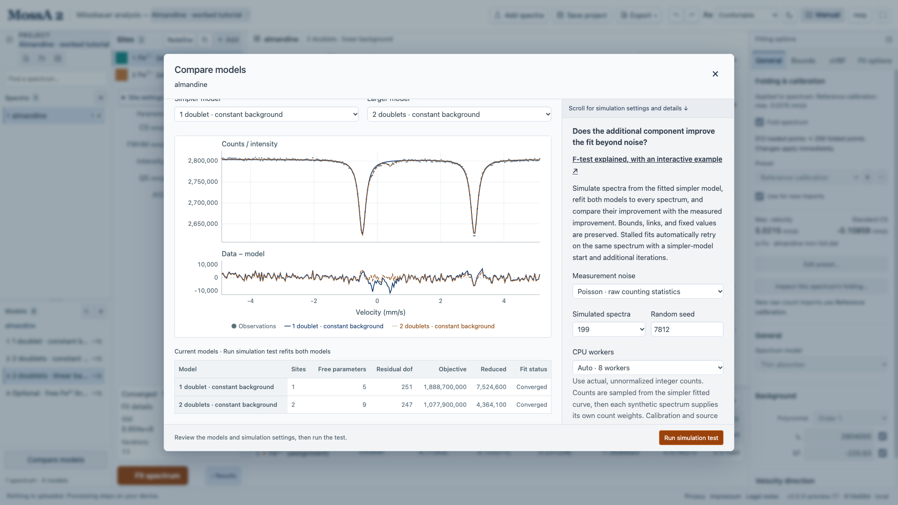
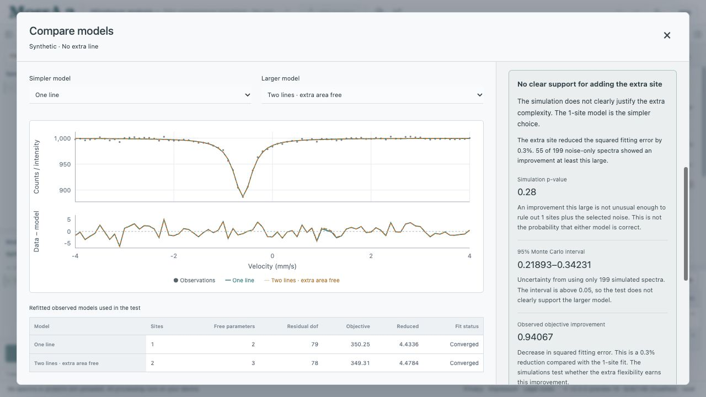
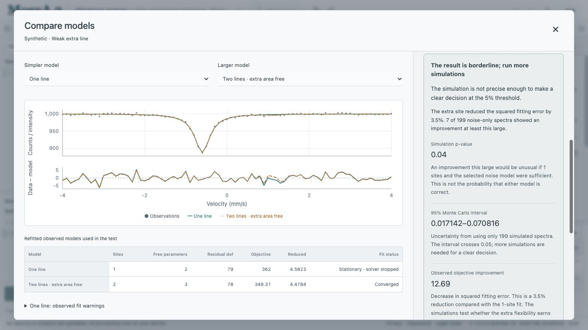

Create at least two models for one spectrum, expand the project sidebar, and choose **Compare models** below its model list. The dialog overlays total curves and residuals and lists site counts, independent parameters, objectives, and fit status. Visual comparison is available even for unfitted models.

For the reasoning, begin with **[More sites? Understanding the F-test](/MossA/manual/foundations/model-comparison/)**. It explains why adding a site lowers the error even for noise, works through the F formula, and includes a step-through animation of actual MossA bootstrap fits. This guide covers the controls.

## Prepare a testable pair

For a simulation test of additional sites:

1. Duplicate the simpler model.
2. Append one or more sites to the copy.
3. Retain the original sites in the same order, with matching profiles, fixed values, fit flags, bounds, and links. Free starting values may differ.
4. Keep the observations, weighting, background constraints, absorber mode, magnetic constants, and transmission source identical.
5. Give each added site a free intensity whose bounds allow zero and positive values. Added sites must not introduce parameter links.

MossA checks these restrictions and verifies that setting the added intensities to zero reproduces the simpler model. Other model pairs can still be compared visually, with an explanation of why the simulation test is unavailable. Changing background order, releasing constraints, or adding components within an existing xVBF distribution is outside the current nesting check.

*The selected pair has the same background constraints. This screenshot illustrates setup and visual comparison; it does not show a completed simulation test or a p-value.*

## Choose a noise model

| Noise model | Appropriate input and assumptions |
| --- | --- |
| **Poisson** | Actual nonnegative integer counts under the stated count model; no normalization or background subtraction |
| **Gaussian** | Unweighted fitting with independent noise of common std, estimated from the simpler fit |

The built-in synthetic example uses Gaussian noise and continuous intensities. Use the Gaussian option for it. For integer-center raw-count folding, the self-paired turnaround is simulated as twice a Poisson count with half the fitted mean. Reversal moves that observation from the first to the last data point; the simulation uses its saved direction.

Count-weighted simulations require positive counts in every simulated observation. A sampled zero invalidates the run; MossA does not replace zeros or discard failed spectra. Unweighted fits are appropriate when low-count Poisson simulations would otherwise fail this requirement. Integer-center folding's self-paired turnaround channel is handled separately when applicable.

## Run and interpret the simulation

Set the random seed and number of simulations, then choose **Run simulation test**. The dialog first refits both observed models in an isolated worker, then generates spectra from the fitted simpler model and refits both models to every simulation. Your project's models remain unchanged.

For B simulations and k simulated improvements at least as large as the observed improvement, the reported p-value is

$$
p = \frac{k+1}{B+1}.
$$

The Wilson 95% Monte Carlo interval describes sampling uncertainty in the simulated tail probability. It does not give the probability that a physical site exists. If it spans a decision threshold you intend to use, increase the simulation count.

The app does not calculate an ordinary F-distribution p-value for added components. The added intensity can vanish at a boundary, where the extra component's shape parameters are unidentified. The F statistic is descriptive.

For a reproducible first test, open the [synthetic no-extra-line project](/MossA/manual/tutorial-data/site-comparison/absent.mossa). Select **One line** as simpler and **Two lines · extra area free** as larger. Choose **Gaussian**, **199** simulations, and seed **12345**. The worked result has 55 exceedances and p = 0.28, so noise explains gains this large often enough to leave no clear support for adding the line. The [weak-line](/MossA/manual/tutorial-data/site-comparison/weak.mossa) example gives p = 0.04 with an interval crossing 0.05; the [clear-line](/MossA/manual/tutorial-data/site-comparison/clear.mossa) example gives p = 0.005. All three are deliberately simplified teaching cases, with fixed line centers and widths.

*The curves nearly coincide. The small improvement does not clearly justify another component: 55 of 199 spectra generated with one line earn at least this much improvement.*

*A p-value just below 0.05 is insufficient for a clear decision when simulation uncertainty crosses that threshold. The one-line fit also retains its numerical warning; inspect the fit diagnostics rather than hiding them.*

## Retain diagnostics

Every requested fit pair must succeed under the app's numerical acceptance checks. Stalled fits retry on the same dataset using bounded recovery starts or continuation, with up to 2,000 iterations per attempt. Recovery does not replace a simulated spectrum. If no acceptable pair is found, the run is invalid; failed spectra do not disappear from the denominator. Inspect convergence, iteration limits, rank, active bounds, recovery attempts, and starting-model-search warnings. Stationarity checks and multiple starts do not guarantee global optimization.

Use **Export comparison report** to save the fitted observed models, observations and preparation, noise assumptions, seed, improvements, and diagnostics. Results remain in the dialog only until it closes. **Cancel simulation** or closing the dialog terminates its worker.

This is a pairwise test under the chosen noise and model assumptions. It does not correct for searching many alternatives or propagate calibration, source, drift, or other systematic errors. The implementation and methodological references are described in the repository's [comparison notes](https://github.com/CPrescher/MossA/blob/main/README.md#comparing-models-and-testing-an-additional-site).
