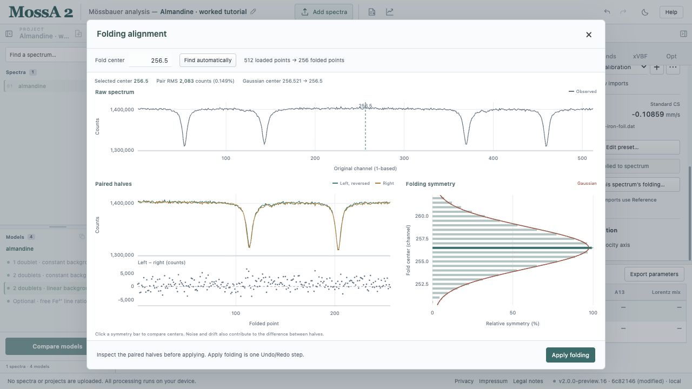
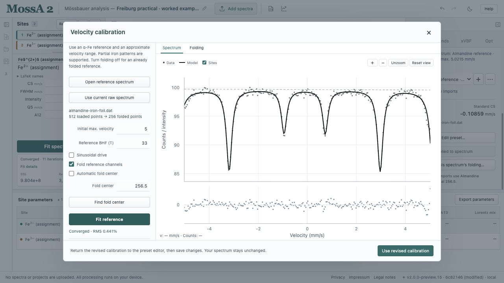
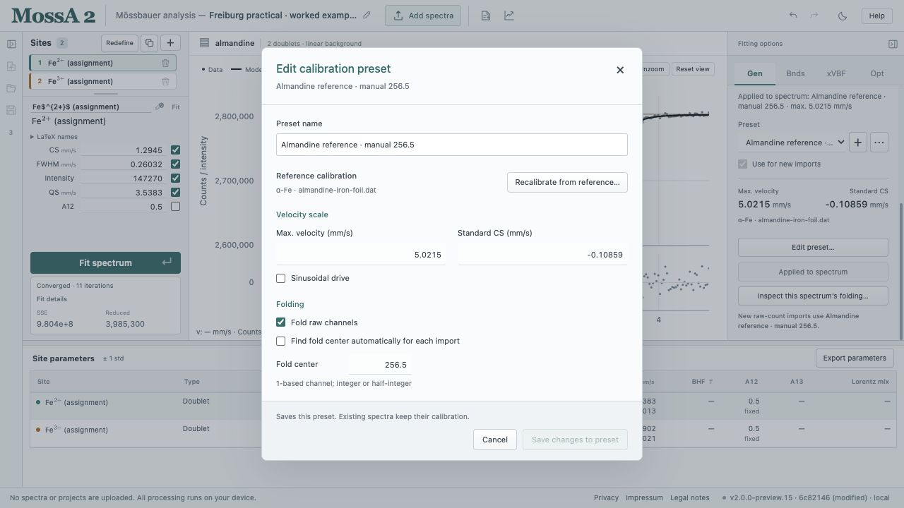
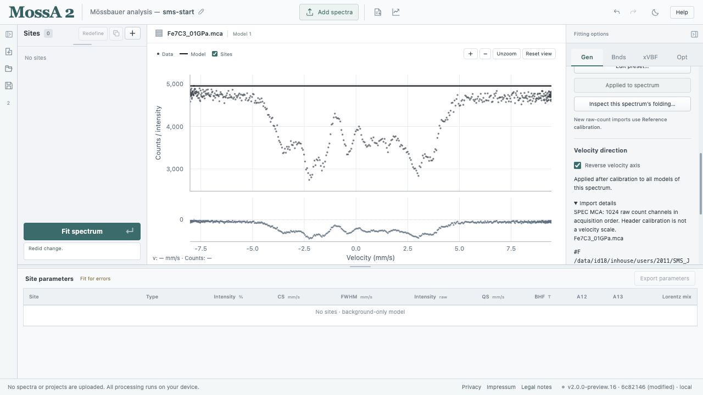

Folding and velocity calibration operate on **raw count channels**. They determine the observations and axis shared by all models of that spectrum. Save the project before revising a calibration used for an important analysis.

## Inspect folding

For a raw sample, open **Gen → Folding & calibration → Inspect this spectrum’s folding…**. The diagnostic view shows:

- Original channels and the chosen center.
- Reversed-left and right counts overlaid.
- Their difference.
- The symmetry scan and its Gaussian refinement, when available.

Fold centers use the original MossA **1-based integer or half-integer channel convention**. The continuous fitted center and the rounded half-channel center are different quantities; both are displayed.

Click a symmetry bar to inspect another center, or enter a center manually. Compare the halves across the whole pattern rather than relying on a single score. **Apply folding** commits the selected center and refolded data as one undoable change. Closing the sample diagnostic without applying leaves the sample unchanged.

**Pair RMS** measures the left-minus-right mismatch over independent pairs. Its percentage is relative to the average counts per half. The symmetry percentage is relative to the current scan window. Neither number is a probability or a calibrated uncertainty; noise and drift can contribute to the mismatch.

*The practical's manual choice and the automatic estimate are separate. Inspecting a center does not change the sample until Apply folding is used.*

## Fit an α-Fe velocity reference

1. Under **Gen → Folding & calibration**, use + to create a preset from an α-Fe reference.
2. Load the reference as one column of counts, or use the current raw spectrum if it is the standard. Loading a reference here does not replace the sample.
3. Enable **Fold reference channels** for an unfolded reference. Leave it off for an already folded spectrum.
4. Select the acquisition's **linear or sinusoidal drive** and enter an approximate initial maximum velocity.
5. Enter the reference magnetic field appropriate to the standard and measurement conditions. The default is **33 T**, retained from the MATLAB workflow; it is an input assumption, not a field measured by the calibration fit.
6. Choose **Fit reference** and inspect the six-line curve, residuals, fitted maximum velocity, center shift, and warnings.
7. Accept and save the preset when the reference fit is satisfactory.

The reference model is a Lorentzian sextet with zero QS and a linear background. Partial six-line patterns can be fitted, but an unsuitable initial velocity range can lead to incorrect line assignments. The workflow does not support arbitrary calibration materials or a nonlinear correction from individually assigned peaks.

Changing a reference's folding center invalidates its previous reference fit. Refit before accepting the calibration.

*This example uses the Freiburg teaching foil and a fixed reference input of 33 T. The displayed maximum velocity and center shift are fitted browser results.*

## Apply or reuse a preset

| Action | Effect |
| --- | --- |
| Select a preset | Preview its saved settings and reference provenance |
| **Apply to this spectrum** | Apply its velocity and folding settings to the current raw-count spectrum |
| **Use for new imports** | Set the default for subsequent raw-count imports |
| **Edit preset…** | Open a separate editor; save explicitly to update the preset |
| **Recalibrate from reference…** | Refit the saved standard or load a replacement reference |

Applying a changed calibration clears obsolete fits in every model of that spectrum. Reapplying an identical scale retains matching completed fits. Other spectra remain unchanged.

Applied spectra retain their own copy of the calibration and the preset name at application time. Editing or deleting the preset does not retroactively change them. If an edited preset is the import default, its saved changes affect future imports. Apply it separately to recalibrate an existing spectrum.

*Saving a preset and applying it to a spectrum are different actions. The editor identifies the saved reference used for this measured teaching example.*

Automatic sample fold centers are found afresh for each import. They do not simply reuse the reference's measured automatic center. A manual preset center is retained when automatic centering is disabled.

## Reverse a sample's velocity direction

Use **Gen → Velocity direction → Reverse velocity axis** when the acquisition requires the opposite direction, as in the [SMS exercise](/MossA/manual/tutorials/sms/). It negates the complete calibrated velocity, including the applied center-shift correction, and preserves count/velocity pairs while ordering the result by increasing velocity.

The direction belongs to the selected spectrum, applies to all its models, and survives later folding or recalibration. Other spectra and import defaults retain their own settings. Changing it invalidates that spectrum's completed fits and can be undone. Site starting values are not transformed; inspect them before refitting.

*The saved checkbox describes a preprocessing choice for this spectrum. Its raw acquisition counts remain available for later recalibration.*

## Keep conventions consistent

Calibration presets also carry the magnetic-coefficient convention. An older preset can therefore preserve older coefficients in new raw-count imports. Existing analyses are not silently converted to newer constants. See [numerical conventions](/MossA/manual/reference/conventions-and-validation/).
