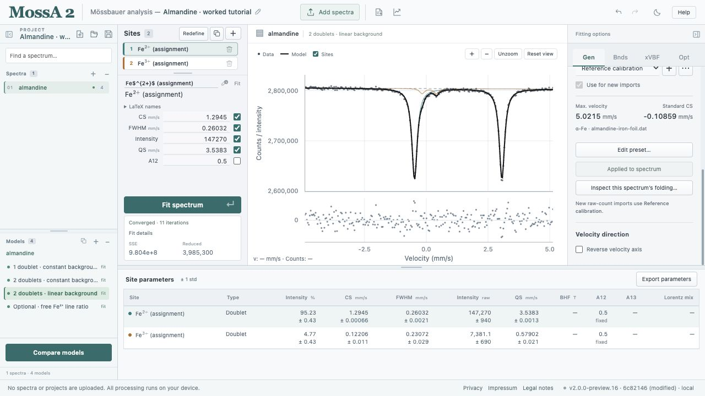

Use **Add spectra** to select one or more plain-text files. Valid files are retained even if another file fails to import; the app identifies the failures.

## Two columns: velocity and counts

Use this form when the velocity axis has already been calibrated. The first column is velocity in mm/s and the second is the measured intensity or counts.

```csv
velocity,counts
-1.0,100010
-0.5,99320
0.0,98110
0.5,99400
1.0,100005
```

This short snippet illustrates the format; it is not a useful fitting dataset. The app sorts observations by velocity and rejects duplicate velocities. A conventional header and comment lines beginning with `#`, `%`, `;`, or `//` are supported.

Two-column files keep their supplied velocity values. Raw-channel folding and velocity calibration controls do not replace that axis.

## One column: raw counts

Use a single column of counts when you want MossA to construct the velocity axis and, if needed, fold the acquisition channels.

```text
# Raw counts in acquisition order
100010
100005
99800
```

Do not sort raw channels by count value. Their order carries the acquisition information. Configure the drive and velocity scale under **Gen → Folding & calibration**. Inspect the folding before fitting an unfamiliar raw spectrum.

Raw-count imports use the calibration preset selected with **Use for new imports**. Choosing a preset for inspection or applying it to an existing spectrum does not automatically make it the import default.



*Check the preset and its import-default checkbox before adding the next raw-count file. The selected spectrum retains its own applied calibration.*

## SPEC MCA and SMS reference files

MossA accepts **single-spectrum SPEC MCA** files with an `@A` count block and `#@CHANN` declaration, including the wrapped rows and continuation characters in the [SMS tutorial](/MossA/manual/tutorials/sms/). It checks the declared channel count and preserves acquisition headers. Header calibration is retained as metadata and does not replace the selected velocity preset. Multiple blocks, truncated data, invalid counts, and inconsistent channel declarations are rejected.

The tutorial's **five-column singlet references** are recognized by their velocity/total/difference/forward/reverse layout, with arithmetic consistency checks. Columns **1–2** are used without normalization. The selection is shown in **Import details** and retained in saved reference metadata. Other five-column layouts must be exported as explicit velocity/count columns.

## Starting models for imported files

Each imported spectrum receives a copy of the active model's site and source settings, a new background estimate, and no completed fit. This is useful for a related series, but you should inspect the starting model for each file. Adding several spectra does not fit them automatically.

## Preserve the measurement record

Keep the original measurement files and record any preparation before import. Normalization, background subtraction, resampling, and folding can change the statistical interpretation of the observations.

For observed-count weighting, every observation must be strictly positive. For a Poisson simulation test, observations must represent nonnegative integer counts under the specified noise model. See [model comparison](/MossA/manual/guides/comparing-models/).

## Unsupported formats

Instrument-specific binary formats, other MCA dialects, and XML importers are not implemented. Export plain text from the acquisition software and verify its axis, channel order, and count definition. MATLAB `.map` project import is also unavailable; `.mossa` browser projects are opened with **Open project**, rather than imported as spectra.
