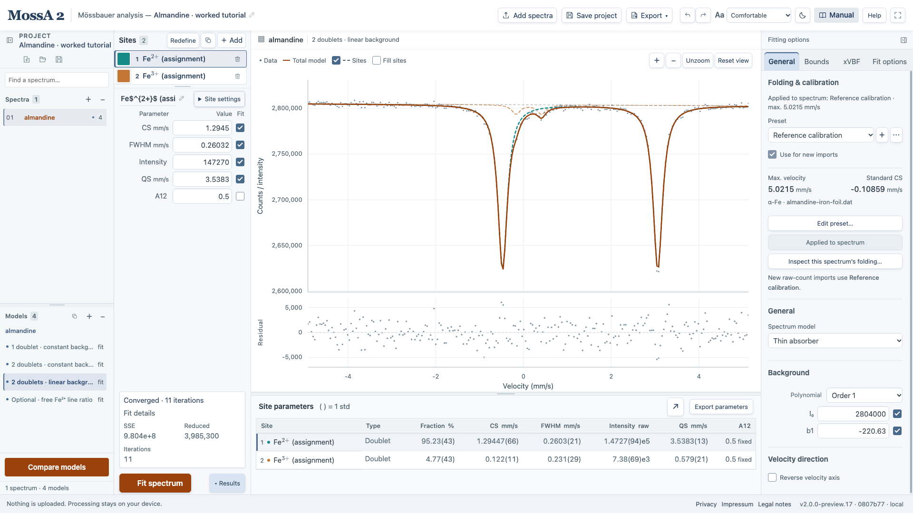

A completed optimization gives a fitted model under the chosen constraints and numerical assumptions. Evaluate its residuals, parameter plausibility, and diagnostics before interpreting the sites physically.

## Residuals and objective

The app's analysis residual is **observed − model**. With observations $y_i$ and predictions $\hat y_i$, the unweighted objective is

$$
S = \sum_i (y_i - \hat y_i)^2.
$$

Observed-count weighting instead uses

$$
S_w = \sum_i \frac{(y_i - \hat y_i)^2}{y_i}, \qquad y_i > 0.
$$

Compare objective values only with their observations, weighting, and fitted range in view. The reduced objective divides the objective by the residual degrees of freedom. It is not, by itself, evidence that a physical interpretation is correct.

Residual structure can expose a wrong peak shape, inadequate background, unresolved components, or preparation problems. A smaller objective after adding parameters is expected; the decrease needs interpretation.

## Parameter uncertainties

The results table reports approximate **1 std** from a local-Jacobian covariance estimate, scaled by the residual variance. It is a local approximation for the chosen model and observations.

*In this measured teaching example, intensity percentages and their std appear separately from raw intensity parameters. The fitted label is a candidate iron assignment, not an automatic chemical identification.*

| Display | Meaning |
| --- | --- |
| `0.12044(33)` | A value of 0.12044 with approximate 1 std of 0.00033 |
| **fixed** | The parameter was held fixed |
| **(—)** | An uncertainty is unavailable; hover for the reason |
| **Not fitted · fit to estimate std** | There is no current completed fit with applicable uncertainties |

Values and std share one line. Parentheses give two significant uncertainty digits in the final quoted value digits; the value is rounded to match. For example, `33.1005(24)` means 33.1005 ± 0.0024. Scientific notation applies the exponent to both the value and parenthetical std. Hovering shows the stored value and the uncertainty explanation. The compact display does not change stored values or CSV precision. Screen-reader cell descriptions expand the uncertainty as “plus or minus.” Select **Results** beside **Fit spectrum** to inspect values and std in the dock below the graph. The editor stays at full height. Drag the divider to resize the table, or select **Expand results** for a full-width comparison; Escape closes that view. Fit status stays visible beside these controls; hiding the table leaves no separate results strip. Columns such as **Lorentz mix** (the editor’s **L fraction**) appear only when at least one site uses that parameter.

Active bounds and unidentifiable parameter directions prevent a suitable symmetric uncertainty. Strong parameter correlations can make values poorly determined even when the fitted curve looks convincing. Linked-parameter errors propagate through their proportional links.

These errors are not MATLAB confidence intervals. They also do not propagate uncertainty in fixed calibration inputs, fixed source shape, or the shared magnetic constants.

Changing data or numerical model settings clears obsolete uncertainties. Renaming a site or model preserves matching fits. Undo can restore an earlier completed fit and its uncertainties without optimizing again.

## Intensity percentages

For site intensity parameters $I_j$, the **Fraction %** column is

$$
F_j = 100\frac{I_j}{\sum_k I_k}.
$$

**Intensity raw** remains available separately. The percentage uncertainty uses the full fitted covariance and is reported in **percentage points**. A ratio fixed exactly by the specified model can have zero std. A zero total intensity gives undefined fractions.

In full transmission, these are **absorber-intensity fractions**. The individual site overlays are display-scaled absorber profiles, not additive transmitted components. Their plotted areas should not be used to reconstruct the transmitted total.

An intensity fraction is not automatically a mineral abundance, mass fraction, or atom fraction. Such an interpretation needs additional physical assumptions and, where applicable, corrections beyond the percentage definition.

## Record the fit status

Read warnings as part of the result. Reaching an iteration limit, rank deficiency, and a parameter at a bound are distinct problems. A numerical stopping code is not silently relabeled as convergence. Keep the completed project and its provenance alongside exported tables and figures.

When std is unavailable, `(—)` is a placeholder rather than a numerical uncertainty. Fixed parameters remain labeled **fixed**. Fit the current model to estimate std; changing only a site’s name or color preserves the completed fit.

Warnings remain visible even when Results is closed. The warning count opens all engine diagnostics directly. A rank-deficient fit displays **std unavailable · rank deficient** above the table; warnings affecting only some parameters retain the parenthetical std key. The expanded table fits its content until the viewport requires scrolling, with all scientific columns retained.

The warning dialog lists fitted or linked parameters whose symmetric std is unavailable, including xVBF fields and background coefficients. **Inspect parameter →** opens the relevant editor directly. This list excludes fixed parameters; it does not infer which underlying constraint is active.
