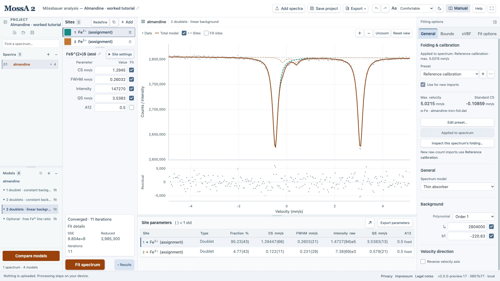
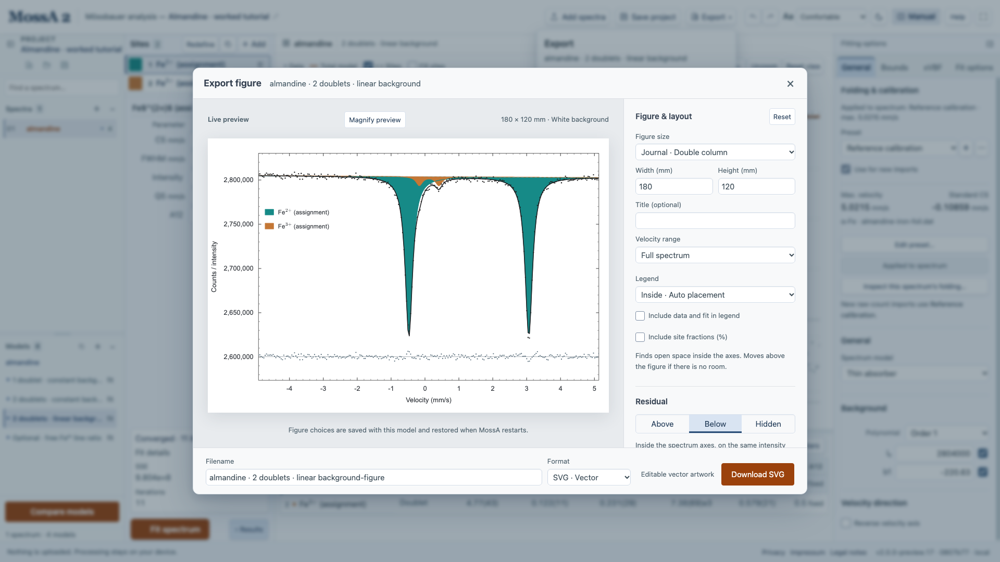

Use a project file to preserve the analysis and exports to communicate its results. They serve different purposes.

## Save a portable project

**Save project** saves a `.mossa` file containing every spectrum and model, raw channels where available, calibration presets and settings, source information, numerical conventions, and completed fit results. The internal format is versioned JSON.

For a new native project, the first save asks for a filename and folder; later saves in that session use the linked file. Opening an existing native project links Save to that file. The browser downloads a file on each save. Save commits the active numeric or site-name edit first. Invalid numbers remain highlighted and must be corrected before saving. ⌘/Ctrl+S uses the same Save command.

The far-left project sidebar contains **New project**, **Open project**, and **Save project** icons. **Open project** accepts current whole-project files and earlier single-spectrum `.mossa`/`.mossa.json` browser projects. Matching completed fits reopen without optimization. The loader discards invalid or mismatched fit metadata while retaining loadable data and model settings.

*Save project retains all spectra and models shown here. A CSV or figure represents only the selected export and does not replace the project file.*

Current projects can use numerical features that older clients do not understand. Keep the app version/commit with an analysis; an older client may reject a newer file instead of silently ignoring its conventions.

Reversed velocity axes use single-spectrum format **3** and collection/autosave format **2**, so older clients reject unsupported direction handling. Import details, original raw channels, acquisition headers where available, and the saved direction are retained. Nonreversed projects keep their existing format rules.

## Understand local autosave

Autosave retains the whole project and panel layout locally, using IndexedDB with a local-storage fallback. In the browser it belongs to the **same browser, device, and app address**; the native app has its own local storage. Clearing that storage removes it. An autosave warning means you should download a project immediately.

Completed fit results are retained. A running fit and graph-placement previews are not saved; **Stop & keep** commits the latest parameter values so they can be saved as the next starting model. Undo/Redo history stays in memory and starts fresh after reload.

**New project** creates an empty project and replaces the local autosave. Undo can restore the previous project while the page remains open. Download a portable backup before starting a separate analysis you want to keep.

## Export numerical data

- **Export → Spectrum data · CSV** in the top toolbar saves the selected spectrum's observations, model, and residuals.
- **Export → Parameter table · CSV**, or **Export parameters** above the results table, saves fitted parameter values and available uncertainties, including intensity percentages.

The parameter CSV retains the original source text of mathematical site names. Exported numbers retain full stored precision rather than the shortened input display.

## Prepare a figure

Choose **Export → Figure · SVG / PNG / EPS / PDF** to open the figure studio. Its white-page preview is separate from the analysis workspace.

1. Under **Velocity range**, choose **Full spectrum**, a saved range when offered, or **Current velocity range** to copy the graph’s horizontal bounds.
2. Under **Figure size**, choose **Journal · Double column**, **Journal · Single column**, or **Presentation · Widescreen**. Editing **Width (mm)** or **Height (mm)** creates a **Custom** size.
3. Under **Sites & colors → Appearance**, choose **Solid fills + outlines**, **Transparent fills + outlines**, or **Outlines**. Edit labels, colors, visibility, and **Layer order** there.
4. Set **Legend** and **Include data and fit in legend**. Optionally enable **Include site fractions (%)**. These are the intensity fractions used in Results, normalized across all model sites, including sites hidden from the figure. In full-transmission mode they are absorber-intensity fractions, not phase abundances. This definition is retained in the exported figure.
5. Under **Residual**, choose **Above**, **Below**, or **Hidden**. **Direction** selects **Data − model** or **Model − data**; state the convention in the figure caption when needed.
6. Under **Format**, choose **SVG · Vector**, **PNG · Image** with **Resolution** at 300 or 600 dpi, **EPS · Vector**, or **PDF · Vector** for printing/sharing. EPS preserves curves and mathematical labels as vectors, outlines text using bundled fonts, and flattens transparent fills against the white page. In the native app, **Save figure…** opens the folder/file dialog; the browser uses **Download SVG/PNG/EPS/PDF**.

Figure settings do not change observations, fitted parameters, or the analysis objective. Exported curves use the evaluated data grid; the figure studio does not perform another fit or interpolate a new model grid.

*Use **Magnify preview** to inspect labels and fine details; select it again to show the complete figure. Magnification changes only the preview. Check the preview before downloading. Figure labels, colors, and layout are export settings; they do not alter the fit.*

Full-transmission figures identify site curves as display-scaled absorber profiles. Preserve that distinction in captions and subsequent figure editing.

## Share a fit report

After fitting, choose **Export → Fit report · PDF** to preview a standard A4 report. The graph appears above a color-matched table with all applicable site parameters in the same row, including intensity, A12/A13, and the Lorentzian mixing fraction. Background/distribution values, fit details, and any fit warnings follow. Longer reports continue onto numbered pages.

The graph uses the model’s saved **Figure** settings, including colors, labels, residuals, and velocity range. Adjust those in **Export → Figure** before opening the report. The report fits that graph onto the page while preserving its aspect ratio. Tables include every model site, even sites hidden from the graph, and retain approximate 1 std, fixed states, and parameter links. Intensity fractions use all model sites.

Use **Download PDF** in the browser or **Save report…** in the native app. Reports require a completed fit for the current model; a stopped fit is labeled with its status and warnings. A report is a sharing copy; save the project file to retain the editable analysis.

## Find the export actions

The header keeps **Save project** separate from **Export**. Save project preserves the full editable workspace. **Export** opens a grouped panel for the active spectrum and model: spectrum CSV, the fitted parameter table CSV, a customizable SVG/PNG/EPS/PDF figure, and a PDF fit report. The parameter-table action becomes available after fitting.

## Repeat exports and save feedback

Figure choices are saved separately with each model in the project file and local autosave: size, title, legend and fractions, residual placement, site overrides, output format, PNG resolution, and filename. Close the figure editor to edit or refit, then reopen it to continue. **Reset** restores the figure defaults. They survive reopening a saved project and restarting MossA, including the selected velocity range. The range selector identifies a saved range when it differs from the current graph view. Native export asks for the filename in the save dialog. Choose solid fills with outlines, transparent fills with outlines (with adjustable transparency from 0 to 100%), or outlines only under Sites & colors. Invalid layout drafts do not replace the last valid layout.

Appending a site keeps existing site-specific choices and gives the new site defaults. Removing sites or an ambiguous change in site order refreshes site-specific export labels, colors, visibility, and order, with a notice, so an override cannot move silently to another site. Overall layout and output settings remain. Unmodified labels and colors follow model changes; explicit export overrides remain separate. **Current velocity range** shows the actual horizontal bounds and does not copy vertical zoom. The selected range is retained on reopening; choose **Full spectrum** to restore the complete velocity axis.

Save and export confirmations appear even when a completed fit is present. Native Save names the destination file; hover over **Save project** or the project title to inspect its currently linked filename. The native **Save project as** icon in the project sidebar (⌘/Ctrl+Shift+S) selects a different destination. Canceling a save leaves the current file target unchanged. Stopping a refit explicitly says whether a previous fit or the starting model was kept.
