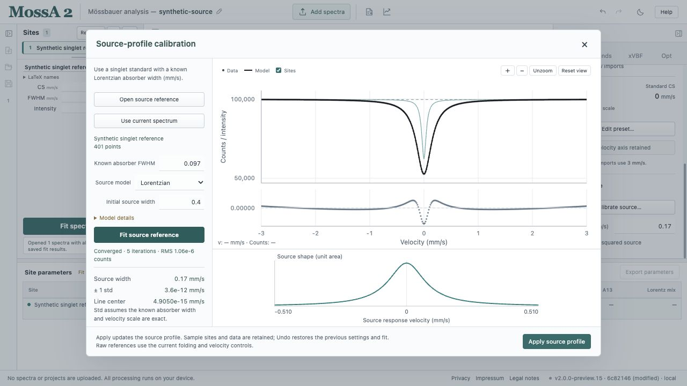

Source profiles enter the **Full transmission integral** model. They describe the response convolved with absorber transmission. Thin-absorber fitting does not use these source settings.

## Use a simple source

In **Gen**, select **Full transmission integral**. Under **Source profile**, set the source FWHM in mm/s and, if appropriate, enable **Lorentzian-squared source**. The squared profile uses the original MossA width convention; do not assume its width parameter has the same interpretation as a Lorentzian's.

## Calibrate from a singlet reference

Choose **Gen → Source profile → Calibrate source…**.

1. Load a suitable singlet reference, or use the current spectrum if it is the reference.
2. Set its known intrinsic Lorentzian absorber FWHM. The default is 0.097 mm/s; replace it when your reference requires another value.
3. Choose a Lorentzian, Lorentzian-squared, or Gaussian-mixture source.
4. Fit and inspect the reference curve, residuals, source width or complete source shape, and diagnostics.
5. Apply the calibration when the reference supports it.

Raw reference files use the current folding and velocity controls. Two-column reference files retain their supplied velocity axis.

Applying the result updates the selected model's source settings and retains the reference. It does not replace sample sites, observations, or spectrum mode. Models have independent source settings; velocity calibration remains shared by all models of a spectrum.

*Illustration using a noiseless synthetic reference generated with absorber width 0.097 mm/s and Lorentzian source width 0.17 mm/s. The very small residual and std result from this construction; they do not represent experimental precision or measured source-extraction validation.*

## Gaussian mixtures

The Gaussian-mixture option fits one to three positive components. Start with the fewest components that can describe the reference. Inspect the full shape, component widths/areas, and reference residuals before adding flexibility.

The calibrated shape is normalized to unit area and zero centroid, then held fixed in subsequent full-transmission sample fits. The complete shape, including asymmetry, is retained in project files and autosave. Under-resolved, rank-deficient, or bound-limited calibrations cannot be applied.

## Interpretation and limits

Use a reference measured under matching source conditions, with comparable or better statistics. The known absorber width and velocity scale are treated as exact. Their uncertainties, and uncertainty in the calibrated source response, are not propagated through later sample-fit errors.

The implementation has selected numerical and measured-transmission checks. Validation of extracting the Gaussian-mixture source from a measured singlet remains outstanding. See the [validation reference](/MossA/manual/reference/conventions-and-validation/) before treating an extracted source as independently established.
