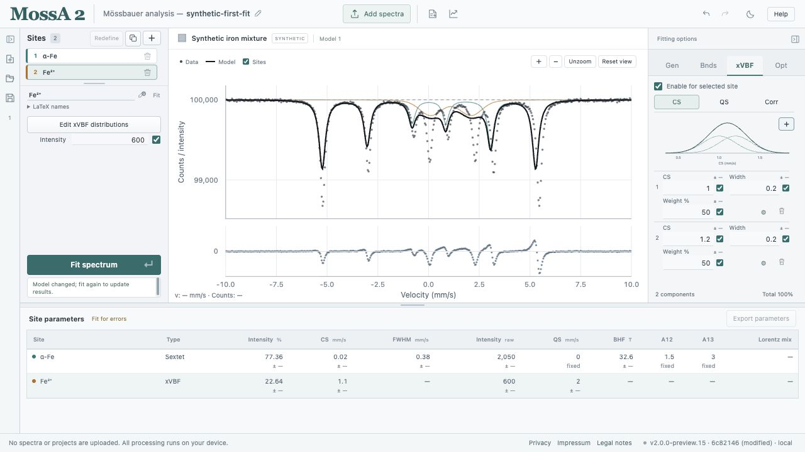
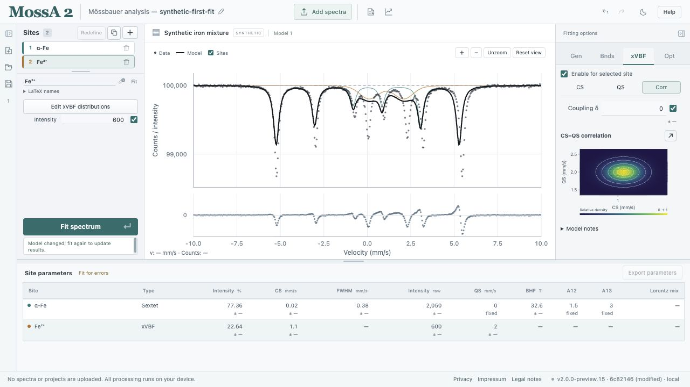
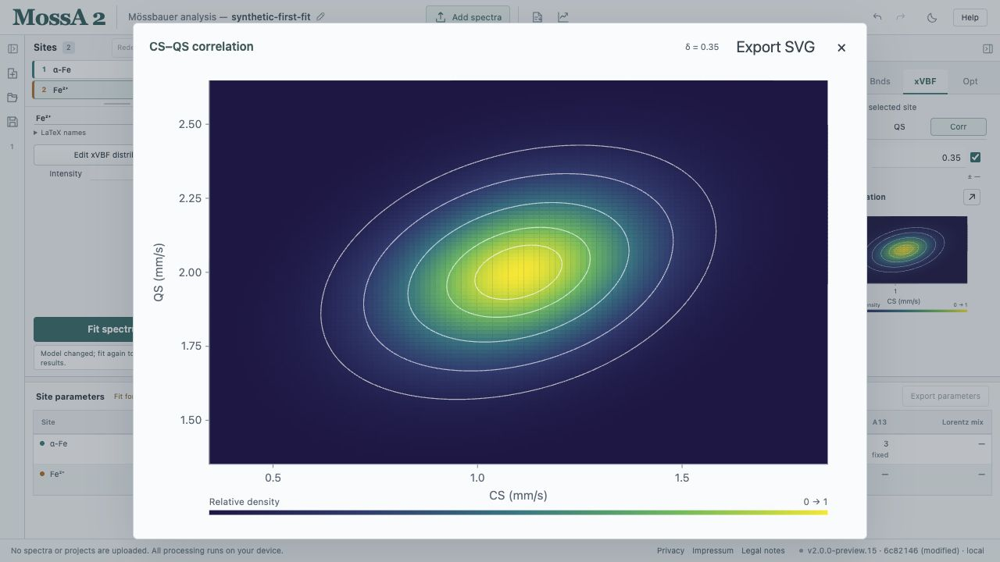

xVBF represents a Lorentzian doublet using Gaussian distributions of center shift (CS) and quadrupole splitting (QS), with a coupling parameter δ. It is an advanced model with additional identifiability constraints.

## Enable and edit distributions

1. Select a **Lorentzian doublet**.
2. Open **xVBF** in the right fitting-options sidebar and enable the distribution model.
3. Use **CS** and **QS** to edit component centers, widths, weights, and fit flags.
4. Open a component's gear to edit its bounds.
5. Use **Corr** to inspect coupling and the joint CS–QS map. Click the map to enlarge it and export SVG.

The spectrum stays visible while you edit distributions. Edits update its model curve and participate in Undo/Redo.

Weights are nonnegative and normalized to 100% separately for each distribution. One varying weight is dependent, so a distribution with N freely varying weights has N−1 independent weight coordinates. The normalization is retained during fitting.

*An editor illustration with two CS components. This modified synthetic starting model has not been fitted; the visible Fit for errors state is intentional.*

## Avoid an underdetermined model

A single symmetric doublet cannot independently resolve both distribution widths and their coupling. The initial QS width is therefore fixed. Releasing several distribution parameters at once can produce an apparently good curve with poorly identified parameters.

Start simply, retain justified constraints, and inspect warnings and uncertainties. More mixture components do not automatically represent additional physical populations.

## Read the plots and table

The result table shows mean CS and QS; individual component parameters and their errors are in the editor. Uncertainty propagation includes the normalization constraint, and weight std values are percentage points.

The one-dimensional plots are marginals of the retained MATLAB joint-density expression. The map's contour levels are **relative density levels**, not confidence or enclosed-probability regions. δ applies to each component pair; for an arbitrary mixture it is not the overall Pearson correlation.

*The synthetic editor starts with δ = 0 in this view. The spectrum and residual remain visible while editing the distribution.*

*The coupling was set manually to illustrate the map. It is not a fitted correlation or a confidence region.*

## Width convention

The fitting core retains MossA's Voigt approximation and distribution-width convention. The Gaussian marginals use those stored widths as the std parameters of the joint-density display. Do not relabel them as a newly inferred spectral FWHM. Zero widths or exactly |δ| = 1 produce singular distributions, shown as ridges or points rather than an artificial finite-width density.

Projects, autosave, and parameter CSVs retain the distribution model. See [numerical conventions](/MossA/manual/reference/conventions-and-validation/) for the distinction between display conventions and fitting formulas.
