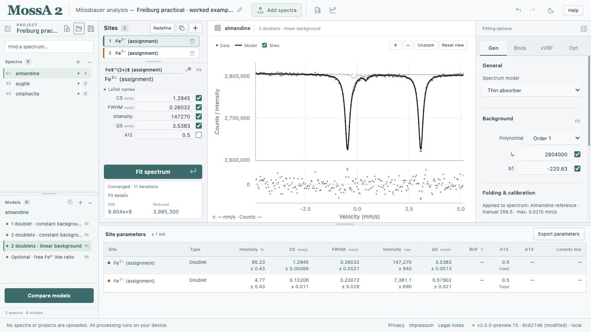

MossA 2 fits Mössbauer spectra directly in your browser. You can prepare a velocity axis, build models from singlets, doublets, and sextets, refine their parameters, and export the results. Calculations run on your device; spectrum files and projects are not uploaded.

[Open MossA 2](https://cprescher.github.io/MossA/) or begin with [your first fit](/MossA/manual/getting-started/first-fit/).

*The Freiburg worked project contains measured almandine, augite, and omphacite spectra. Each spectrum has its own model alternatives; the displayed fits are new browser examples.*

## Choose a starting point

| You want to… | Read… |
| --- | --- |
| Try the app with a complete example | [Your first fit](/MossA/manual/getting-started/first-fit/) |
| Follow the Freiburg measured-data practical | [Almandine](/MossA/manual/tutorials/almandine/), then [augite and omphacite](/MossA/manual/tutorials/clinopyroxenes/) |
| Analyze a synchrotron-source magnetic spectrum | [SMS Fe₇C₃ tutorial](/MossA/manual/tutorials/sms/) |
| Find the controls | [The workspace](/MossA/manual/getting-started/workspace/) |
| Load measured data | [Importing spectra](/MossA/manual/guides/importing-data/) |
| Fold channels or calibrate velocity | [Folding and velocity calibration](/MossA/manual/guides/folding-and-calibration/) |
| Add sites, bounds, and parameter links | [Building and fitting models](/MossA/manual/guides/building-models/) |
| Interpret fitted values and errors | [Reading results](/MossA/manual/guides/reading-results/) |
| Save an analysis or prepare a figure | [Saving and exporting](/MossA/manual/guides/saving-and-exporting/) |

## Projects, spectra, models, and sites

A **project** contains one or more spectra. Each **spectrum** stores its observations and velocity axis, and can have several alternative **models**. Each model contains a background, source settings, and a collection of **sites**. A site represents a spectral component; assigning it a mineral or electronic state remains a scientific interpretation.

This structure lets you compare interpretations of the same observations while retaining the parameters and completed fit of each model.

## Scope of this edition

This manual describes the **MossA 2 browser preview** on the repository's `mossa2` branch. The original MATLAB application is retained on `main` and under `reference/MossA/`; its interface and file formats differ.

The manual is a first edition under development. It covers the current analysis workflow, the Freiburg conventional-source/clinopyroxene practical, and selected advanced features. Detailed mathematical derivations, additional measured-data cases, and instrument-specific workflows remain to be added. The app's footer identifies its running version and commit.

Before reporting research results, read [numerical conventions and validation](/MossA/manual/reference/conventions-and-validation/), including the distinction between implementation checks and agreement with measured spectra.
