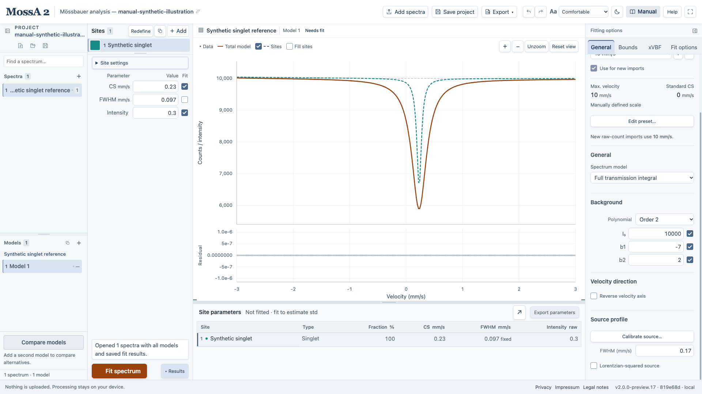

MossA 2 retains many numerical expressions from the original MATLAB MossA while using a Rust/WebAssembly fitting core. Matching an expression, recovering synthetic parameters, and agreeing with measured reference analyses are different kinds of evidence.

The [physics overview](/MossA/manual/foundations/physics/), [line-profile equations](/MossA/manual/foundations/line-shapes/), and [transmission derivation](/MossA/manual/foundations/transmission-integral/) distinguish the ideal physical expressions from the current code's width, normalization, and finite-grid conventions.

## Relationship to the MATLAB application

The retained MATLAB source corresponds to commit `d201482b7990afbd0e2dcc23e306bfc8d60a5049`, apart from its license update. The browser app preserves selected line-shape, folding, calibration, and transmission conventions.

The bounded trust-region-reflective optimizer is different from MATLAB's optimizer. Iteration counts, trajectories, stopping criteria, and fitted values can differ. Browser uncertainties are local-Jacobian approximate 1 std, rather than MATLAB confidence intervals.

MATLAB `.map` import, instrument-specific binary/XML importers, MCA dialects other than the supported single-spectrum SPEC layout, and the original formatted reporting workflow are not implemented. Multiple spectra and independent model alternatives are supported; batch, sequential, and global fitting are separate features that are not currently provided.

## Profile and intensity conventions

- The Lorentzian is area-normalized with half-width = FWHM/2.
- Gaussian expressions retain the original rounded constants `0.8326` and `1.7725`.
- Pseudo-Voigt uses `mix × Lorentzian + (1 − mix) × Gaussian`.
- Lorentzian-squared retains its original expression and width convention.
- Doublet centers are CS ± QS/2; its A12 is the first-line area fraction.
- Sextet line shifts and line-area ratios follow the selected magnetic-coefficient convention and the retained QS expression.
- Intensity percentages are ratios of site intensity parameters, including in full transmission.

In particular, the squared profile's actual FWHM is its legacy width parameter times $\sqrt{\sqrt2-1}$. The sextet's line-area normalization preserves the total raw site intensity as A12/A13 change. Intensity ratios refer to count-deficit profiles in thin mode or integrated optical-depth profiles in transmission mode; they do not integrate the transmitted dips. The [equation reference](/MossA/manual/foundations/line-shapes/) gives the explicit expressions.

The full-transmission calculation retains the finite −30 to +30 mm/s grid with 0.01 mm/s spacing, source convolution, and interpolation convention. FFT convolution is checked against directly summed convolution. Site overlays show scaled absorber profiles and are not additive transmission components.

*This is a generated illustration with a known source width, not measured validation data. The mode and source controls help identify which numerical model is being evaluated.*

The xVBF fitting and joint-density display have specific legacy width conventions. Consult [xVBF distributions](/MossA/manual/guides/xvbf/) before interpreting those widths or map contours.

Velocity reversal follows MATLAB's `data.x = -data.x` after calibration, with paired observations reordered to increasing velocity in the browser. It is saved as spectrum preprocessing and reapplied after raw-channel recalibration. The original acquisition channels and calibration standard are retained.

## Versioned ⁵⁷Fe magnetic coefficients

New analyses use the convention `fe57-iaea-2019-2020-codata2022`, with unrounded central coefficients for the outer, middle, and inner line-pair half-separations per tesla:

| Pair | Coefficient (mm/s/T) |
| --- | --- |
| Outer | 0.1612785758490726 |
| Middle | 0.09338354131598467 |
| Inner | 0.02548850678289673 |

The extra calculation digits remove rounding; they do not imply that the physical constants have that experimental precision. The derivation and source documents are recorded in the repository's [coefficient recommendation](https://github.com/CPrescher/MossA/blob/main/validation-data/constants/RECOMMENDATION.md).

An older project without convention metadata always means `mossa-legacy-rounded`, with coefficients 0.1613, 0.0934, and 0.0255 mm/s/T. Opening or refitting it does not silently convert the analysis. Raw-channel imports inherit the selected calibration convention, so a legacy preset can preserve legacy constants in a new spectrum.

Projects and calibration references retain their conventions. Changing a convention is a numerical model change and invalidates incompatible fit metadata. Shared systematic uncertainty in these fixed coefficients is not included in the reported fit std.

## What has been checked

The repository includes automated checks of profile expressions against independent transcriptions, synthetic recovery, fixed/bounded/linked parameters, uncertainty diagnostics, folding and calibration, direct transmission convolution, file restoration, browser interactions, and compiled WASM execution.

Selected measured transmission cases have also been compared with the actual SYNCmoss engine. That agreement concerns the tested isotropic Lorentzian cases and supplied source response. It is not a validation of every model or of extracting a Gaussian-mixture source from a measured singlet.

## What remains open

The independent MATLAB-expression fixtures are **not MATLAB execution output**. Broad comparisons with measured spectra and saved MATLAB models/results remain incomplete. The SMS tutorial's measured Lorentzian-squared singlet refits reproduce its quoted mean source width, but are new browser calculations rather than independently exported MATLAB results. Gaussian-mixture source extraction and xVBF still need suitable measured reference validation. The synthetic teaching example is not evidence of agreement with experimental data.

For the detailed record, consult the [porting notes](https://github.com/CPrescher/MossA/blob/main/PORTING.md), [validation log](https://github.com/CPrescher/MossA/blob/main/VALIDATION.md), and [measured SYNCmoss comparison](https://github.com/CPrescher/MossA/blob/main/validation-data/syncmoss-sms/README.md). These records describe specific checks and their limits; no general equivalence to every original MATLAB workflow is claimed.
