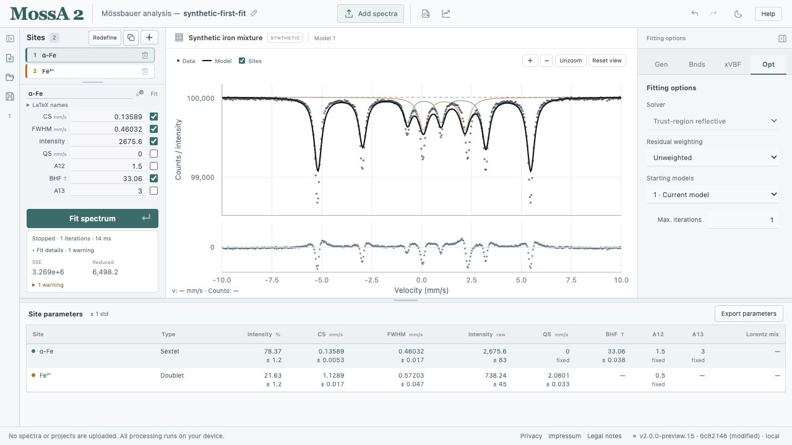

## A spectrum will not import

Check that the file contains one count column, two velocity/count columns, a recognized five-column SMS reference, or the supported single-spectrum SPEC MCA layout. For velocity-column files, look for duplicate velocities. SPEC channel declarations must match the actual count block. Other binary, MCA, and XML formats need export to plain text before import. Use **Open project** for `.mossa` files rather than Add spectra.

## The velocity axis is wrong

For raw channels, check maximum velocity, drive type, center shift, folding state, and the preset selected for imports. A two-column file retains its supplied axis. Selecting a preset previews it; choose **Apply to this spectrum** to change the current raw-count spectrum. Inspect a reference fit before applying its scale.

Also inspect **Gen → Velocity direction → Reverse velocity axis**. The SMS sample needs reversal after calibration. Reversal is a saved property of that spectrum and remains applied after recalibration; toggling it again restores the other direction and invalidates obsolete fits.

## Folding looks asymmetric

Inspect both halves and their difference in the folding diagnostic. Check whether the input is already folded and whether the acquisition matches the chosen center/drive assumptions. Noise and drift affect symmetry scores. A high relative symmetry score alone does not establish correct folding.

## A fit stops without convergence

Read Status and Fit details. Inspect the starting positions, widths, background, bounds, links, and fixed parameters. Increase the iteration limit if the fit is still progressing, or try several **Starting models** when alternative minima are plausible. Keep the stopping code and warnings with the result.

*This warning was produced deliberately with a one-iteration limit on the synthetic starting model. It is a troubleshooting illustration, not an accepted final analysis.*

## Errors are missing

**Fit for errors** means the current model needs fitting. **Fixed** parameters have no fitted symmetric uncertainty. **± —** can indicate an active bound or an unidentifiable direction; hover for the reason. Simplify an overparameterized model or add justified constraints. Small residuals alone do not establish parameter identifiability.

## An intensity percentage is undefined or has zero std

All-zero site intensity gives undefined percentages. An exactly fixed or linked ratio can have zero std within that model, including the 100% fraction of a single nonzero site. It does not imply zero uncertainty in the model's physical interpretation.

## Compare models will not run a simulation

Create a nested pair by duplicating the simpler model and appending sites. Check the dialog's stated reason: changed original sites, background constraints, source, weighting, or added-site links can prevent testing. Poisson simulations require actual integer counts; the built-in synthetic example needs Gaussian noise. See [comparing models](/MossA/manual/guides/comparing-models/).

## My completed fit disappeared after an edit

Changes to observations, calibration, or numerical model settings invalidate old fits and uncertainties. Calibration changes affect all models of that spectrum. Undo can restore the preceding fitted state while its history is available. Renaming and plot navigation preserve fits.

## My work did not return in another browser

Autosave is local to the browser, device, and app address. Open a downloaded `.mossa` project to transfer work. Clearing site storage also removes autosave. If the app reports a storage failure, use **Save project** immediately.

## I cannot find spectra or fitting options

Use the project and options sidebar icons. A fresh session starts with the project sidebar collapsed. Individual panes scroll separately; drag their dividers to give a list or editor more room. The results table also has a resizable height.

## The app reports an update

Save the project before reloading. The app checks build metadata but never reloads automatically. Use the version control in the footer to inspect the changelog and reload when ready. Include the version and source commit when reporting a reproducible issue through the [repository](https://github.com/CPrescher/MossA/issues).
