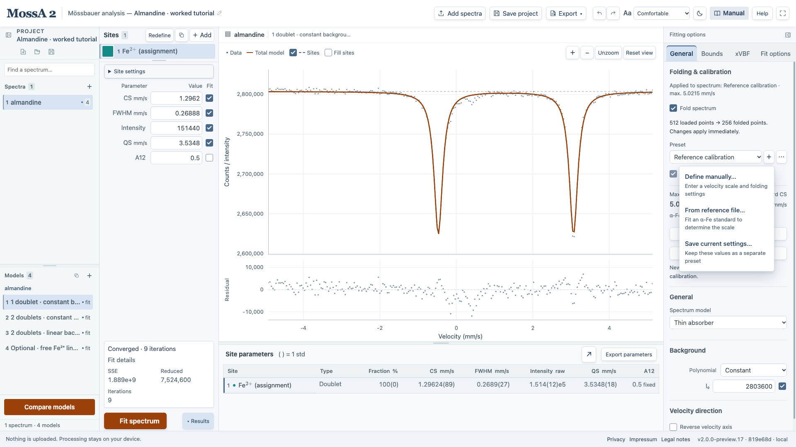
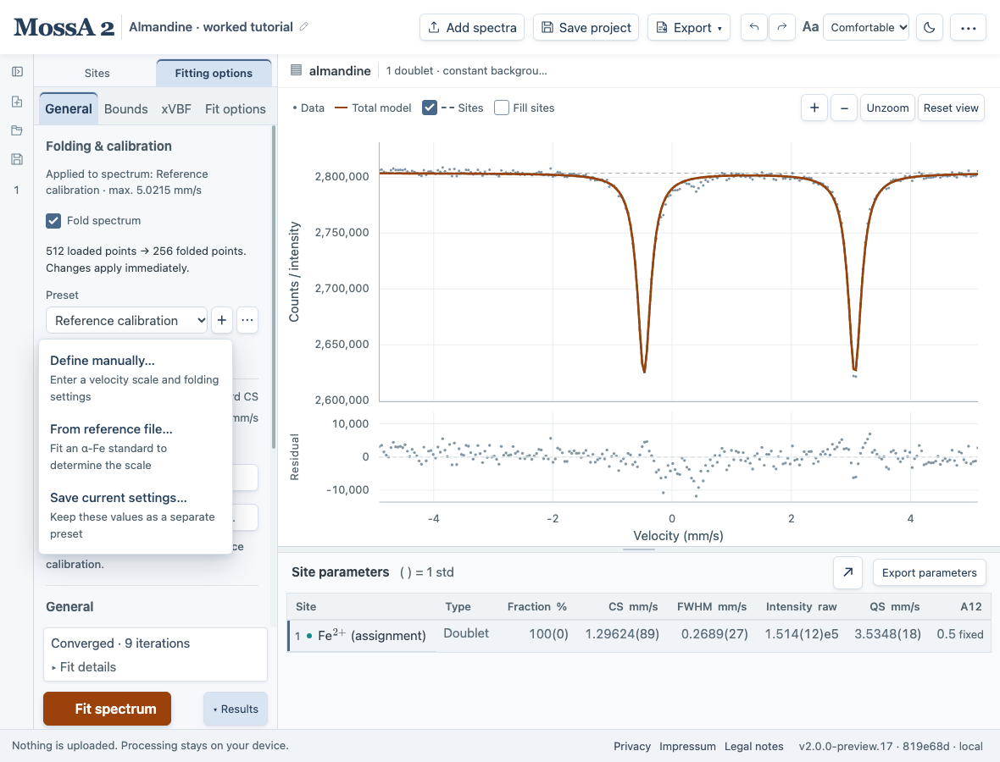

This tutorial adapts the conventional-source MossA tutorial used in the Freiburg **Geowissenschaftliche Analytik** practical. You will calibrate a linear velocity scale with an iron foil, fit the dominant doublet of a natural almandine, inspect its residuals, add a second doublet, and refine the background.

The required part corresponds to **steps 1–7 of the original tutorial**, as specified by the practical. Freeing a line-area ratio is an optional extension, followed by saving and exporting.

## Watch the beginner tutorial

Follow the complete workflow from importing raw counts through folding, velocity calibration, fitting, and saving a project. The video uses the almandine sample and matching iron foil available below, with narration and highlighted controls.

<iframe class="tutorial-video" width="960" height="540" src="https://www.youtube-nocookie.com/embed/O1YcE0maGtE" title="MossA beginner tutorial: import, fold, calibrate, fit, and save" loading="lazy" referrerpolicy="strict-origin-when-cross-origin" allow="encrypted-media; picture-in-picture; fullscreen" allowfullscreen></iframe>

[Watch on YouTube](https://www.youtube.com/watch?v=O1YcE0maGtE) · 11 min 19 s · English narration and optional English subtitles. An internet connection is required; the desktop manual provides the YouTube link instead of an embedded player.

| Jump to | Topic |
| --- | --- |
| [00:00](https://www.youtube.com/watch?v=O1YcE0maGtE) | Start here |
| [00:28](https://www.youtube.com/watch?v=O1YcE0maGtE&t=28s) | Import and folding |
| [02:30](https://www.youtube.com/watch?v=O1YcE0maGtE&t=150s) | Velocity calibration |
| [05:27](https://www.youtube.com/watch?v=O1YcE0maGtE&t=327s) | Build and fit |
| [07:07](https://www.youtube.com/watch?v=O1YcE0maGtE&t=427s) | Improve and inspect |
| [10:10](https://www.youtube.com/watch?v=O1YcE0maGtE&t=610s) | Save and reopen |

Recorded November 9, 2026 with the MossA 2 develop preview. The video imports the sample before calibrating; the written steps below calibrate the foil first. Both use the same measured data. Consult the written guide for current controls and the optional line-area-ratio extension.

## Download the measured data

| Download | Original course filename | Contents |
| --- | --- | --- |
| [Almandine iron foil](/MossA/manual/tutorial-data/freiburg/almandine-iron-foil.dat) | `Alm Fe-Foil.dat` | 512 raw count channels |
| [Almandine sample](/MossA/manual/tutorial-data/freiburg/almandine.dat) | `Alm sample.dat` | 512 raw count channels |

The download names are simplified; the file contents are unchanged. Both are **one-column raw-count files**. Load the foil in the velocity-scale calibration dialog and the sample with Add spectra. Do not import them as already calibrated velocity/count pairs.

:::note[Keep your current work]
Save any existing project before starting. You can begin with **New project**, or retain other spectra and give the tutorial a clearly named model. Existing sample sites are copied to newly imported spectra, so remove unwanted sites from the tutorial model before building its doublets.
:::

## 1. Calibrate the velocity scale

This step uses the iron foil to determine the **velocity scale in mm/s** and its center-shift correction for the sample. It also sets up folding of the raw channels.

:::tip[Where to find velocity-scale calibration]
Open **Fitting options → General → Folding & calibration**. On a wide screen, Fitting options is the panel on the **right**; if hidden, use **Show fitting options** at the edge of the graph. On a laptop, select **Fitting options** above the editor shared with Sites. On a tablet or narrow screen, select the **Fitting options** view, then the **General** tab.

The similarly named **Fit options** tab contains solver settings such as residual weighting. Velocity-scale calibration is in **General**.
:::

*On a wide screen: right-hand **Fitting options → General → Folding & calibration → + → From reference file…**. The worked sample provides context; loading a foil in this dialog does not replace the sample.*

*On a laptop: select **Fitting options** above the editor, then **General** and the + beside Preset. **From reference file…** opens velocity-scale calibration.*

1. Open **Fitting options → General → Folding & calibration → + (Add calibration preset) → From reference file…**.
2. In **Velocity calibration**, choose **Open reference spectrum** and load `almandine-iron-foil.dat`.
3. Leave **Sinusoidal drive** unchecked for this **linear** acquisition.
4. Enable **Fold reference channels**. Disable **Automatic fold center** and enter **256.5**, following this practical's specified manual-folding workflow.
5. Use an initial maximum velocity of **5 mm/s** and a reference field of **33 T** for this worked example. The reference field is a fixed calibration input; use a value established for your own standard in research analyses.
6. Choose **Fit reference**. Inspect the line positions, residuals, and warnings. Some outer lines lie at or beyond the measured range; MossA fits the complete sextet model.
7. Choose **Continue with calibration**, enter **Almandine reference** in **Preset name**, and choose **Save preset**. Select **Use for new imports** before importing the sample.

*Use the foil acquired with this sample. A reference from another acquisition may have a different calibration even when its velocity range is similar.*

With the current browser implementation, the 33 T reference assumption, modern magnetic coefficients, and manual center 256.5, the example calibration gives a maximum velocity of about **5.02155 mm/s** and a standard center shift of **−0.10859 mm/s**. These are newly calculated browser results, not values transcribed from the original MATLAB tutorial. Subtracting this center shift is part of constructing the sample's velocity axis.

## 2. Load the sample

Use **Add spectra** to import `almandine.dat`. Under **Fitting options → General → Folding & calibration**, confirm that the intended velocity-calibration preset is the import default and that manual folding remains enabled at **256.5**. In **General**, choose **Thin absorber** and a **Constant** background. In **Fitting options → Fit options**, use **Unweighted** residuals.

The dominant absorption pair has a center near 1.3 mm/s and a splitting near 3.5 mm/s. These are starting estimates from this example, not constraints that should replace an inspection of the graph.

## 3. Fit one Lorentzian doublet

1. Remove inherited sites from the tutorial's selected model if necessary.
2. In **Sites**, choose **＋ Add**. In **New site**, choose **Site type → Doublet**, **Line profile → Lorentzian**, then **Define on graph**.
3. Click one line's position and depth, set its half-width with the second click, and click the other line.
4. Keep **A12 = 0.5 fixed**, so the two lines have equal areas.
5. Choose **Fit spectrum**.
6. Rename this model **1 doublet · constant background**.

*Inspect the residual rather than deciding from the total curve alone. The remaining structure motivates testing another component.*

## 4. Add the weaker doublet

Duplicate the fitted model so you retain the one-doublet result. Append another Lorentzian doublet to describe the weak residual absorption near the center of the pattern. A starting CS of approximately **0.2–0.4 mm/s**, QS around **0.6 mm/s**, and width around **0.3 mm/s** is useful here. Keep its A12 fixed at 0.5 and fit again.

The lower-CS component is the candidate ferric component in the teaching interpretation. Its name does not establish that assignment. Check CS, splitting, sample context, and model dependence together.

## 5. Allow a linear background

Duplicate the two-doublet model, choose **General → Background → Order 1**, and fit again. Both background coefficients should be checked if you intend to refine them. Name this model **2 doublets · linear background**.

*The required tutorial ends here. Compare this model with the simpler alternatives before interpreting the remaining differences.*

The downloadable worked project uses CS bounds −0.5 to 2 mm/s, QS bounds 0.05 to 5 mm/s, FWHM bounds 0.03 to 1.5 mm/s, nonnegative intensities, fixed equal doublet areas, unweighted residuals, and up to 1,000 iterations. These bounds and iteration settings are explicit choices for this browser example; the original handout does not prescribe them.

Inspect one newly calculated worked result

Under the stated settings, the required two-doublet/linear-background example gives approximately:

| Component, teaching assignment | CS (mm/s) | QS (mm/s) | FWHM (mm/s) | Intensity (%) |
| --- | --- | --- | --- | --- |
| Fe²⁺ candidate | 1.2945 | 3.5383 | 0.2603 | 95.23 |
| Fe³⁺ candidate | 0.1221 | 0.5790 | 0.2307 | 4.77 |

These are a reproducible example fit, not certified composition values or an official answer key. The project retains full precision, constraints, calibration reference, and fit diagnostics.

[Download the almandine worked project](/MossA/manual/tutorial-data/freiburg/almandine.mossa).

## Optional: free the dominant doublet's area ratio

The practical explicitly says to skip the original tutorial's steps 8 and 9 for its required analysis. To explore them separately, duplicate the linear-background model, select the dominant doublet, check **Fit A12**, and refit.

For a doublet, A12 is the **first-line area fraction**, not an unconstrained ratio. A12 = 0.5 means equal areas. Inspect whether freeing it changes the residuals and the weaker component's intensity fraction. In the supplied worked fit, the weaker fraction changes from about **4.77% to 5.68%**. This illustrates model dependence; a better fit alone does not identify preferred orientation or a Goldansky–Karyagin mechanism.

## Save and continue

Save the whole project, export parameters, and prepare a figure with **Export → Figure**. The original tutorial's MATLAB report and Save Sites controls are replaced here by the browser's project, CSV, SVG, PNG, EPS, and PDF exports.

Continue with [comparing models](/MossA/manual/guides/comparing-models/) to learn how to assess added components.
