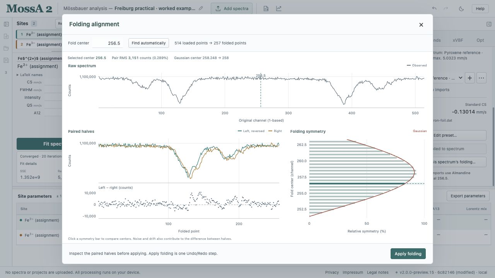
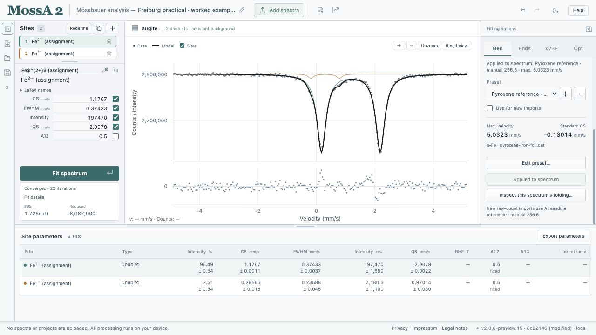
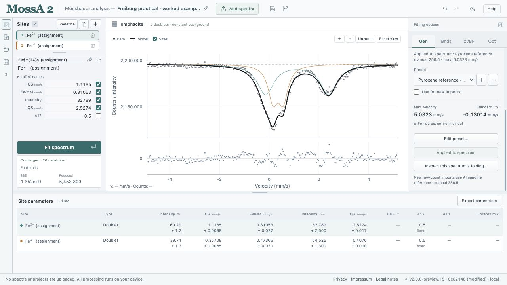

The Freiburg practical asks you to analyze two clinopyroxenes, **augite** and **omphacite**, and estimate Fe³⁺/ΣFe from their fitted doublet areas. Complete the [almandine tutorial](/MossA/manual/tutorials/almandine/) first if you are unfamiliar with calibration, site definition, and residual inspection.

This chapter adapts the practical's **data-analysis section** to MossA 2. Its laboratory preparation, spectrometer geometry, and electronics exercises remain in the course handout; the browser instructions are not an equipment operating procedure.

## Download the measurements

| Download | Original course filename | Raw channels |
| --- | --- | --- |
| [Pyroxene iron foil](/MossA/manual/tutorial-data/freiburg/pyroxene-iron-foil.dat) | `cpx Fe-foil.dat` | 514 |
| [Augite](/MossA/manual/tutorial-data/freiburg/augite.dat) | `augite.dat` | 514 |
| [Omphacite](/MossA/manual/tutorial-data/freiburg/omphacite.dat) | `omphacite.dat` | 514 |

The files contain one column of raw counts. The bytes are unchanged; only the foil's download filename is simplified.

## 1. Inspect the specified folding

The handout specifies **manual folding at 256.5** with automatic folding disabled. Use that setting consistently for the foil and sample spectra when reproducing this worked exercise.

:::caution[Channel count and fold center are separate]
These particular files contain **514**, rather than 512, count values. Their geometric midpoint would be 257.5, and the current symmetry scan's best candidate for the foil is 258. The worked project deliberately retains the handout's **256.5** setting and all 514 values. It does not trim channels or silently substitute an automatic center. Inspect both halves and treat a different center as a separately documented preparation choice that requires recalibration and refitting.
:::

*Compare the halves and their difference. The score describes mismatch; it does not certify the handout's center or assign its uncertainty.*

## 2. Calibrate with the pyroxene foil

1. Create a separate preset through **Gen → Folding & calibration → + → From reference file…**.
2. Load `pyroxene-iron-foil.dat` in the reference dialog.
3. Use a **linear** drive, an initial maximum velocity of **5 mm/s**, folding enabled, automatic center disabled, and **256.5** as the manual center.
4. Use **33 T** as the reference field for this worked exercise, then choose **Fit reference**.
5. Inspect the reference curve and residuals, accept the result, and save a named **Pyroxene reference** preset.
6. Select **Use for new imports** before importing augite and omphacite. If they are already loaded, use **Apply to this spectrum** on each one separately.

The current worked calibration gives approximately **5.03229 mm/s** maximum velocity and **−0.13014 mm/s** standard center shift. These are new browser calculations under the specified settings, not values provided by the handout. The almandine and pyroxene calibrations are distinct even though both start near 5 mm/s.

## 3. Fit augite

Import `augite.dat`, choose **Thin absorber**, a **Constant** background, and **Unweighted** residuals. Remove inherited sites that do not belong to this model.

Start with one Lorentzian doublet, fit it, and inspect the residual. Duplicate that model and add a second doublet, keeping **A12 = 0.5 fixed** for both. The handout indicates that two doublets suffice for the intended minimum model.

Useful starting estimates here are CS near **1.2 mm/s** and QS near **2 mm/s** for the dominant pair, with a weaker lower-CS component near **0.3 mm/s**. Use the graph to establish its initial splitting and width rather than treating those guesses as measured results.

*The lower-CS component is weak. Check whether its parameters and fraction remain stable under reasonable changes to the model.*

## 4. Fit omphacite

Import `omphacite.dat` using the same pyroxene preset. Fit one doublet as a baseline, then duplicate the model and add a second doublet. Use the same spectrum mode, weighting, and initial background choice as for augite.

The lower-CS contribution is more evident here. Inspect the residual over both doublets and check the fitted widths; a broad component can accommodate unresolved structure without establishing a unique microscopic site model.

## 5. Make and state the iron assignment

Use fitted **CS**, the sample's mineralogical context, and the room-temperature interpretation discussed in the practical to assign candidate Fe²⁺ and Fe³⁺ components. The lower-CS doublet is assigned to Fe³⁺ in this teaching interpretation. A label entered into MossA does not perform that assignment or verify it.

The original handout refers to McCammon's 2004 chapter in *Spectroscopic Methods in Mineralogy* for the CS interpretation diagram. Its third-party figure is not reproduced here. CS ranges depend on spin, coordination, temperature, and reference convention; avoid a universal hard cutoff.

## 6. Calculate the area-based estimate

For the exercise's two assigned components, calculate

$$
R_{\mathrm{area}} = \frac{I_{\mathrm{Fe^{3+}}}}{I_{\mathrm{Fe^{2+}}}+I_{\mathrm{Fe^{3+}}}}.
$$

The table already reports **Intensity (%)**. Divide the assigned ferric percentage by 100 to obtain this ratio. For several ferric components, sum their intensity parameters before dividing by the total.

Under the exercise's simplifying assumption of comparable effective recoil-free fractions and an adequate thin-absorber representation, this is used as an estimate of Fe³⁺/ΣFe. MossA calculates spectral intensity fractions; converting them to an atomic ratio remains an interpretation with additional physical assumptions.

Compare with newly calculated browser worked examples

The downloadable fits use the stated manual center, the 33 T pyroxene calibration, modern magnetic coefficients, two equal-area Lorentzian doublets, a fitted constant background, unweighted residuals, and at most 1,000 iterations. CS bounds are −0.5 to 2 mm/s, QS bounds 0.05 to 5 mm/s, FWHM bounds 0.03 to 1.5 mm/s, and intensities are nonnegative.

| Sample | Lower-CS candidate CS (mm/s) | Its QS (mm/s) | Its intensity (%) | Area-based ratio |
| --- | --- | --- | --- | --- |
| Augite | 0.2956 | 0.9701 | 3.51 | 0.0351 |
| Omphacite | 0.3571 | 0.4076 | 39.71 | 0.3971 |

These are example browser refits, not archived MATLAB answers or independent measurements of composition. The listed bounds and iteration settings are choices for this adaptation. Inspect the stored fit diagnostics and local uncertainties in the project; they do not include uncertainty in folding, the reference field, or model choice.

[Augite worked project](/MossA/manual/tutorial-data/freiburg/augite.mossa) · [Omphacite worked project](/MossA/manual/tutorial-data/freiburg/omphacite.mossa) · [All three samples and model stages](/MossA/manual/tutorial-data/freiburg/freiburg-practical.mossa)

## 7. Investigate model dependence

The practical's optional question asks how the ratio varies with the fitting model. Retain the two-doublet model, duplicate it, and explore a justified change such as an additional doublet or a linear background. Change one aspect at a time and record its effect on the residuals, widths, and assigned ferric fraction.

**Compare models** can overlay the alternatives. Its simulation test has stricter nesting requirements: keep the original sites and constraints and append new sites; changing background order is outside the current verifier. A lower objective alone does not prove a new physical population.

## Report your analysis

Record the reference file and field, fold center, drive, weighting, magnetic convention, model constraints, fitted CS/QS/widths, ferric intensity fraction, and the assumptions used to interpret it. Include residuals and discuss model dependence. Save the `.mossa` project as well as the parameter CSV and figure.

File hashes, original filenames, and the worked calibration settings are available in the [data provenance record](/MossA/manual/tutorial-data/freiburg/provenance.json). The source handout's sample-preparation and spectrometer-setting exercises have not been converted into instructions for unsupervised equipment use.
