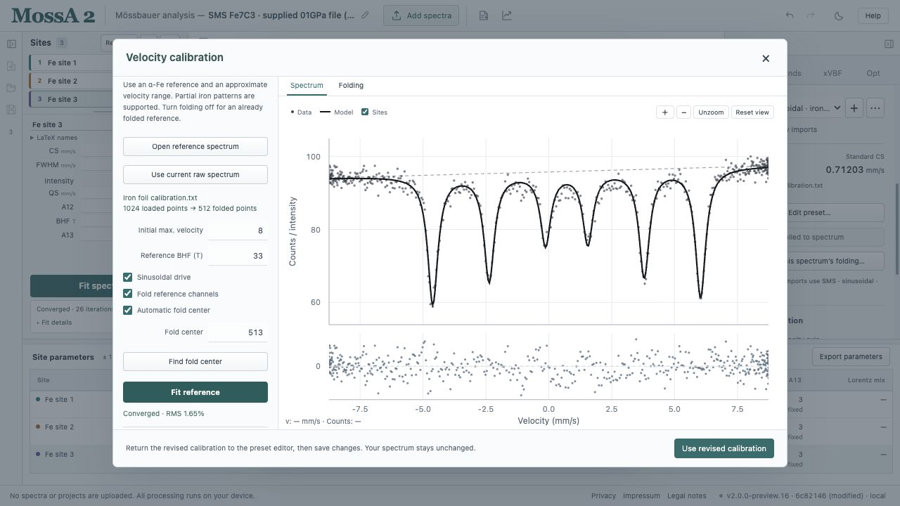
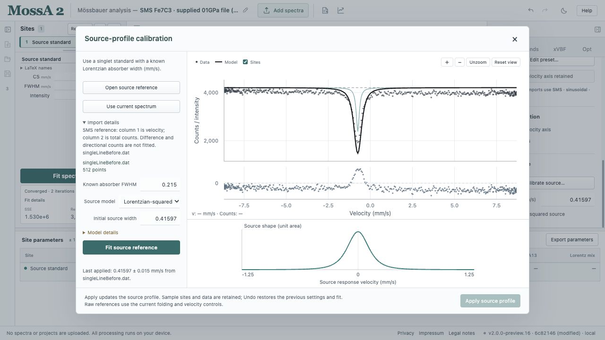
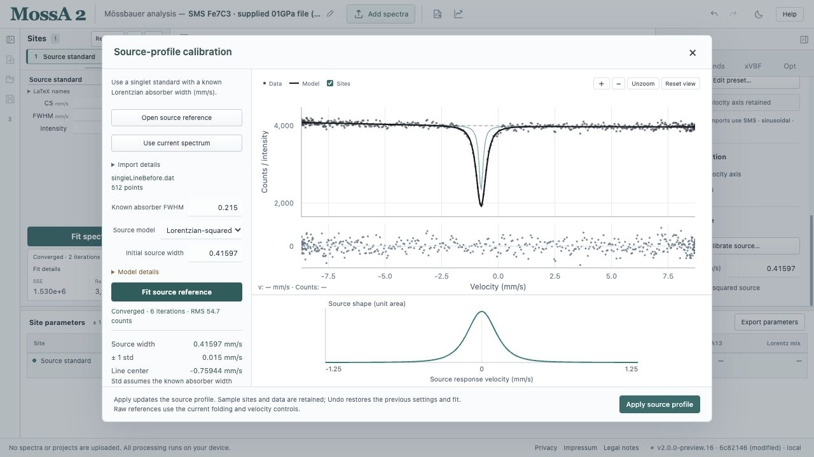
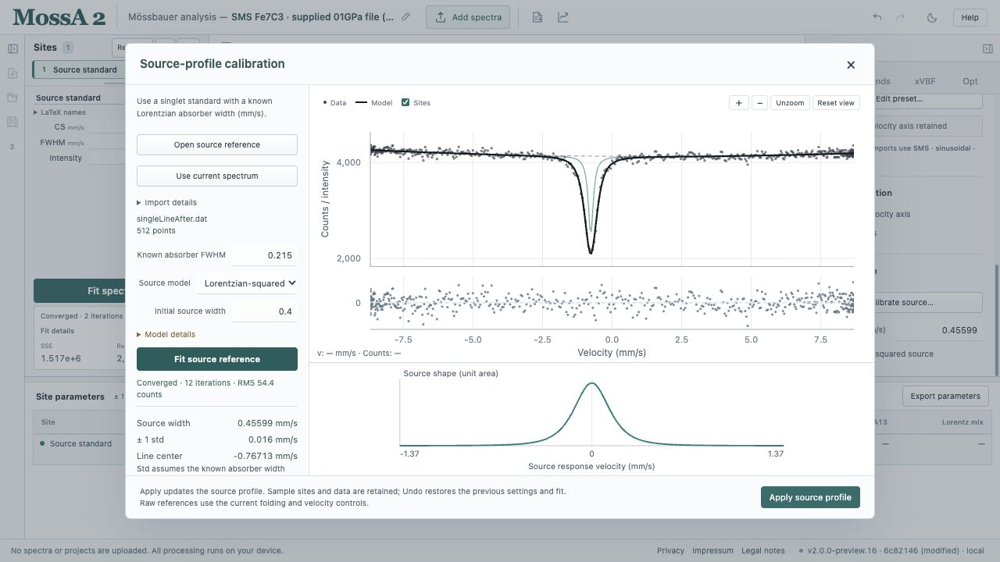
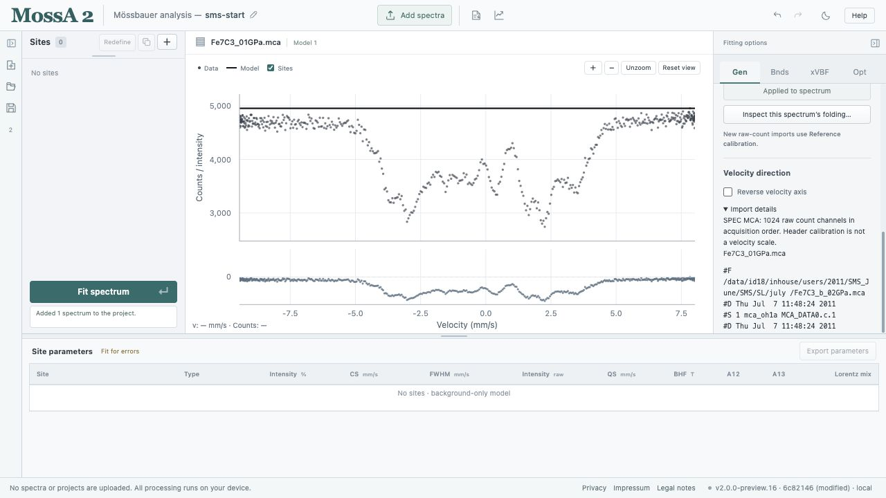
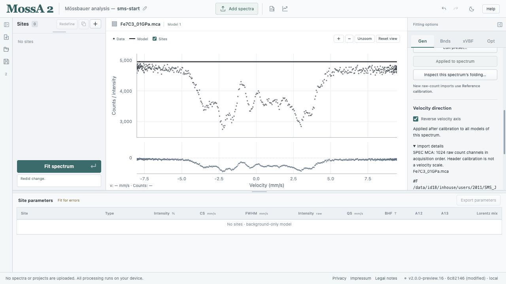
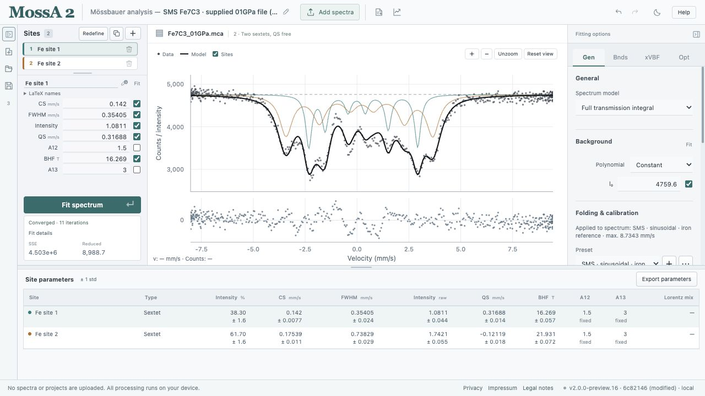
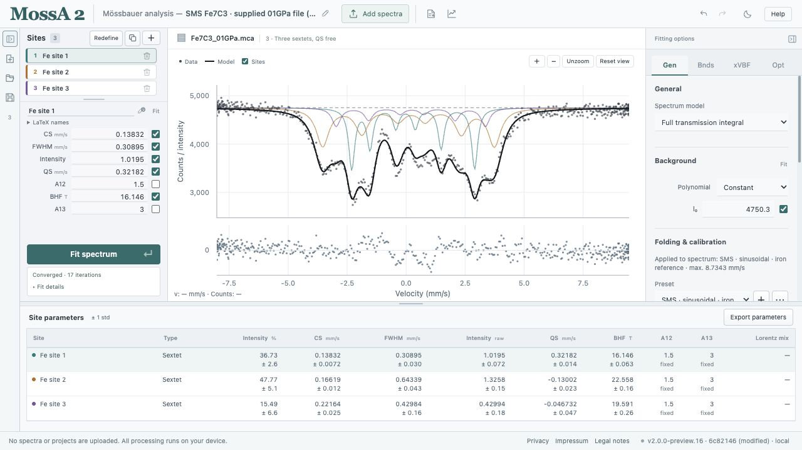
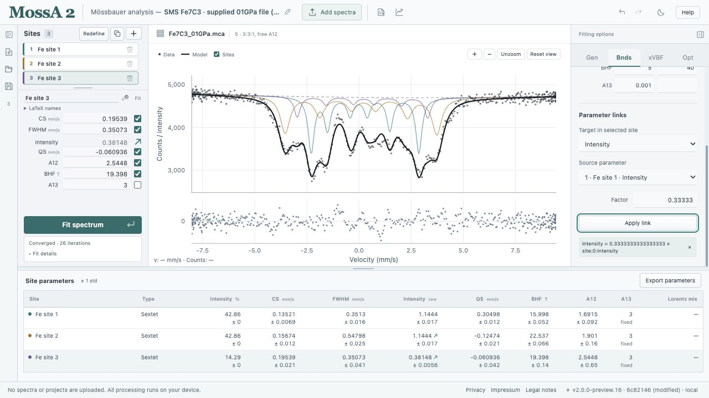
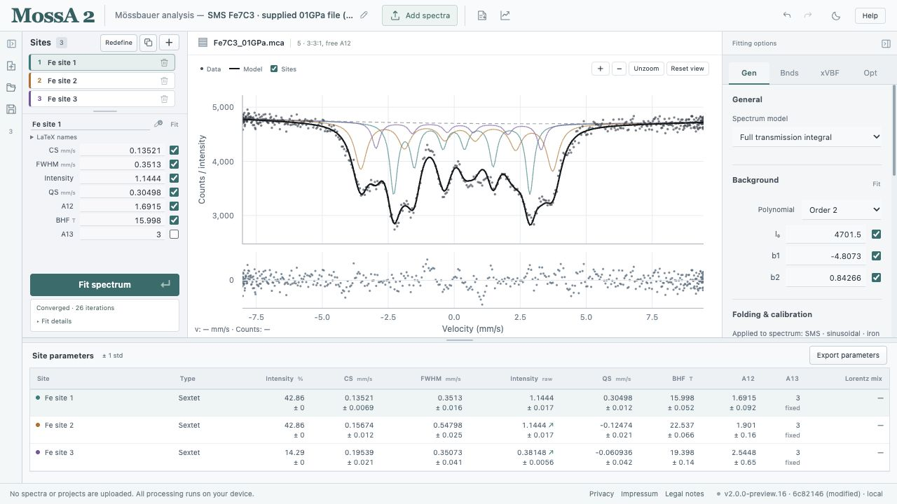

This advanced tutorial adapts **MossA tutorial SMS.pdf** from the Freiburg teaching materials. It uses the supplied synchrotron Mössbauer source (SMS) measurements: an iron foil, singlet standards measured before and after the experiment, and a magnetic Fe₇C₃ spectrum. You will calibrate the velocity scale, determine a Lorentzian-squared source width, reverse the sample's velocity direction, and fit progressively constrained full-transmission models.

Complete [your first fit](/MossA/manual/getting-started/first-fit/) or the [almandine tutorial](/MossA/manual/tutorials/almandine/) first. Keep the original files; this workflow does not require editing or converting them before import.

:::caution[Pressure label is unresolved]
The source tutorial and sample filename describe **1 GPa**, but the MCA file's internal `#F` header names `Fe7C3_b_02GPa.mca`. Both labels are retained. The tutorial demonstrates analysis of the supplied spectrum; it does not independently establish its pressure. Do not cite a resolved pressure from this worked example.
:::

## Download the original measurements

| File | Input format | Role |
| --- | --- | --- |
| <a href="/MossA/manual/tutorial-data/sms/Iron%20foil%20calibration.txt" download>Iron foil calibration.txt</a> | 1,024 raw count channels | Velocity reference |
| <a href="/MossA/manual/tutorial-data/sms/singleLineBefore.dat" download>singleLineBefore.dat</a> | 512 rows, five columns | Source standard before the sample measurement |
| <a href="/MossA/manual/tutorial-data/sms/singleLineAfter.dat" download>singleLineAfter.dat</a> | 512 rows, five columns | Source standard after the sample measurement |
| <a href="/MossA/manual/tutorial-data/sms/Fe7C3_01GPa.mca" download>Fe7C3_01GPa.mca</a> | SPEC MCA, 1,024 channels | Sample spectrum |

All four downloads retain the original filenames and bytes. Hashes, format selections, assumptions, and the pressure-label discrepancy are recorded in [provenance.json](/MossA/manual/tutorial-data/sms/provenance.json).

## 1. Calibrate the sinusoidal velocity scale

1. Save your existing project and start a tutorial project.
2. Open **Gen → Folding & calibration → + → From reference file…**.
3. Load `Iron foil calibration.txt` in the velocity-reference dialog.
4. Enable **Sinusoidal drive**, **Fold reference channels**, and **Automatic fold center**.
5. Set the initial maximum velocity to **8 mm/s**, as specified in the original tutorial.
6. Use **33 T** as the fixed iron-reference field for this worked example, then choose **Fit reference**.
7. Inspect the six-line fit, residuals, fitted scale, and warnings. Accept the calibration and save a named **SMS · sinusoidal · iron reference** preset.
8. Select **Use for new imports** before loading raw sample channels.

*The reference field is an input assumption. The scale and center shift shown here are newly calculated browser results, not values copied from an archived MATLAB fit.*

With modern magnetic coefficients and the stated settings, the automatic fold center rounds to **513**, the fitted maximum velocity is about **8.73429 mm/s**, and the standard center shift is about **0.71203 mm/s**. The full source convention and reference counts are saved with the preset.

## 2. Understand the five-column singlet references

These `.dat` files are already on a velocity axis. Their columns are:

1. Velocity in mm/s.
2. Total counts.
3. Forward-minus-reverse counts.
4. Forward counts.
5. Reverse counts.

MossA recognizes this layout only when the total and difference agree with the directional counts within the printed numerical precision. It fits the **recorded columns 1–2**, preserving the total counts rather than recomputing or normalizing them. **Import details** identifies that selection. Unrelated five-column tables are rejected rather than assigned columns by guesswork.

The reference files retain their supplied velocity values. The raw-channel sinusoidal calibration is for the iron foil and sample; it is not applied again to these velocity-column standards.

*This panel records the column selection. The difference and directional columns are auxiliary measurements, not three additional spectra to fit.*

## 3. Calibrate the source before the experiment

Under **Gen**, choose **Full transmission integral**, then open **Source profile → Calibrate source…**. You need a spectrum loaded to expose these model controls; either load `singleLineBefore.dat` first or use the dialog from an existing tutorial spectrum.

1. Choose **Open source reference** and select `singleLineBefore.dat`, or choose **Use current spectrum** if that standard is already selected.
2. Set **Known absorber FWHM** to **0.215 mm/s**, the reference-width assumption specified in the source tutorial.
3. Select **Lorentzian-squared** as the source model and use an initial source width around **0.4 mm/s**.
4. Choose **Fit source reference**.
5. Inspect the reference curve, residuals, source shape, source width, and approximate 1 std. Record the width before applying it.

*This is a measured standard. The source-width error is a local fitting std with the absorber width and velocity axis treated as exact.*

The browser worked fit gives approximately **0.41597 ± 0.01515 mm/s**. Applying this result changes the selected model's source settings and retains the reference; it does not replace the sample data or sites.

## 4. Repeat after the experiment and set the mean

Repeat the same procedure with `singleLineAfter.dat`, the same **0.215 mm/s** absorber width, and the **Lorentzian-squared** model.

*Compare the two measured references before deciding to represent the experiment with one fixed source width. Their difference can reflect source variation as well as fitting noise.*

The after fit gives approximately **0.45599 ± 0.01555 mm/s**. Following the original exercise, use the arithmetic mean:

$$
\Gamma_{\mathrm{source}} = \frac{\Gamma_{\mathrm{before}}+\Gamma_{\mathrm{after}}}{2}
\approx 0.43598\ \mathrm{mm/s}.
$$

This reproduces the tutorial's quoted value of about **0.436 mm/s**. Enter that mean under **Gen → Source profile → FWHM (mm/s)** and retain **Lorentzian-squared source** for the sample model. The mean is held fixed in subsequent sample fits; the reported sample std does not propagate source drift, absorber-reference uncertainty, or uncertainty in this mean.

The individual widths are not automatically averaged by the app. Record both values and enter the mean explicitly. [Dedicated source-calibration results](/MossA/manual/tutorial-data/sms/source-calibrations.json) retain the two source fits separately.

## 5. Import the original SPEC MCA sample

Use **Add spectra** and select `Fe7C3_01GPa.mca`. The import dialog now accepts `.mca` files. For this supported SPEC layout, MossA reads the single `@A` block, joins continued count rows in acquisition order, and verifies that their number matches `#@CHANN`. The sample contains **1,024** counts and folds to **512** points.

The original header is retained under **Gen → Velocity direction → Import details**, including its conflicting internal filename. `#@CALIB` is preserved as acquisition metadata; it is not interpreted as a Mössbauer velocity calibration. Truncated files, extra counts, invalid values, and multiple count blocks are rejected.

*Check the applied sinusoidal preset and the original header. The worked data are not reassigned a pressure during import.*

If you loaded the sample before setting the import default, choose the SMS preset and **Apply to this spectrum**. Confirm that the source profile for the sample model is Lorentzian-squared with the mean width. Imported spectra copy the active model's source settings; a calibration preset determines the velocity axis, not the source response.

## 6. Reverse this sample's velocity axis

The original tutorial calls for **Flip Signs** because the sample measurement used a reversed velocity direction. In MossA 2, enable **Gen → Velocity direction → Reverse velocity axis** for the selected sample.

*This reverses calibrated velocity, not the raw acquisition file. All models of this spectrum use the same observations and direction.*

If the calibrated coordinate is $v$, the operation uses $v'=-v$, including the standard-center correction already applied. Observations remain paired with their velocities, then are reordered to increasing velocity for calculation. Raw channels, the saved reference, and the preset are retained. Site starting parameters are not transformed, so inspect or rebuild the sample model after reversal.

The direction remains applied when folding or calibration is revised. Toggling it again restores the original direction. The operation clears obsolete fits in every model of this spectrum and is one Undo step. It does not set the default direction of future imports.

:::note[Saving reversed analyses]
Reversed analyses use single-spectrum project format **3** and collection/autosave format **2**. Older clients reject those versions rather than losing the reversal on later recalibration. Projects without reversal retain their existing format conventions.
:::

## 7. Begin with two magnetic sextets

1. Remove any inherited singlet or unrelated sites from the selected sample model.
2. Select **Full transmission integral**, a **Constant** background, **Unweighted** residuals, and the mean squared-source width.
3. Define two **Lorentzian sextets** on the graph: outer line position/depth, half-width, then the opposite outer line.
4. Useful starting fields for this supplied spectrum are about **16.5 T** and **21.5 T**, with CS around **0.25 mm/s** and widths around **0.3 mm/s**. These are starting estimates for the example, not reference measurements.
5. Initially hold QS at zero. Keep **A12 = 1.5** and **A13 = 3** fixed, then fit.
6. Duplicate that model. Check **Fit QS** for both sextets and fit again.

*This first stage is deliberately incomplete. Keep it as a model alternative so the effect of releasing QS and adding a third sextet remains visible.*

QS for a magnetic sextet uses MossA's magnetic-line shift convention; it is not the nonmagnetic doublet's CS ± QS/2 formula. Allowing QS is a model choice motivated by the original exercise. A nonzero fitted value alone does not determine a unique local structure.

*Compare this stage with the zero-QS model. Additional flexibility improves the fit without yet including the third component used by the exercise.*

## 8. Add a third sextet

The source tutorial uses a three-iron-site structural interpretation of Fe₇C₃. Duplicate the two-sextet/QS-free model and append a third Lorentzian sextet. A starting field around **19 T**, CS around **0.25 mm/s**, width around **0.3 mm/s**, and a smaller intensity are useful for this example. Enable its QS fit flag and fit again.

*These are three fitted spectral components under the exercise's structural interpretation. Inspect residuals, widths, correlations, and alternative starting models before accepting the parameter assignment.*

## 9. Link intensities in the ratio 3:3:1

The exercise imposes a **3:3:1** site-occupancy-based intensity model. In **Bnds → Parameter links**, define the targets explicitly:

| Selected target | Source | Factor |
| --- | --- | --- |
| Site 2, Intensity | Site 1, Intensity | `1` |
| Site 3, Intensity | Site 1, Intensity | `0.3333333333333333` |

For each target, select **Intensity**, choose the source **1 · Fe site 1 · Intensity**, enter the factor, and choose **Apply link**. The convention is **target = factor × source**. Do not reverse the factor when changing which site is selected.

*Linked targets are not independent optimization coordinates. The constraint applies to absorber-intensity parameters, not the visible areas of transmission overlays.*

Choose **Gen → Background → Order 2** and refit. In this constrained model the intensity fractions are **42.857%, 42.857%, and 14.286%** by construction. Their fixed-ratio std may be zero within the model; that is not an independent determination of site occupancy. Equating spectral intensity ratios to populations also requires physical assumptions about the relevant recoil-free fractions and model adequacy.

## 10. Explore the sextet line ratios

Duplicate the constrained model and check **Fit A12** for each sextet, retaining A13 = 3. Fit again. This follows the original tutorial's exploration of line-area ratios in a small diamond-anvil-cell sample.

*The model's source width and velocity calibration are fixed inputs. The source-shaped transmission total is fitted; colored site overlays are scaled absorber profiles and are not additive transmitted components.*

A lower objective after freeing A12 does not, by itself, establish preferred orientation or another specific mechanism. Keep the fixed-ratio alternative and examine whether the improvement is meaningful for the intended interpretation.

## Inspect the worked project

[Download the worked SMS project](/MossA/manual/tutorial-data/sms/sms-worked.mossa). It contains all five sample model stages, both measured singlet references with their source-calibration records, the iron-reference preset, original MCA headers and channels, reversal state, and completed fits. [An unfitted start project](/MossA/manual/tutorial-data/sms/sms-start.mossa) contains the calibrated sample in its original direction, with no sites, to practice the reversal and model-building steps.

The example uses modern magnetic coefficients, automatic fold centers of 513 for the foil and sample, unweighted fitting from the current start, and at most 1,000 iterations. Each sextet has CS bounds −2 to 3 mm/s, BHF bounds 5 to 40 T, FWHM bounds 0.03 to 2 mm/s, QS bounds −3 to 3 mm/s, and nonnegative intensity. These are explicit settings for this browser adaptation; they are not prescriptions for every SMS experiment.

One newly calculated final sample fit

| Site | CS (mm/s) | BHF (T) | QS parameter (mm/s) | Width parameter (mm/s) | A12 |
| --- | --- | --- | --- | --- | --- |
| 1 | 0.1352 | 15.998 | 0.3050 | 0.3513 | 1.6915 |
| 2 | 0.1567 | 22.537 | −0.1247 | 0.5480 | 1.9010 |
| 3 | 0.1954 | 19.398 | −0.0609 | 0.3507 | 2.5448 |

These are example browser refits with the stated constraints, not archived MATLAB results or certified material parameters. The final unweighted objective is about **3.196 × 10⁶**. Other starts, source choices, calibration conventions, or physical constraints can change the fit. Full precision, local std, and diagnostics are retained in the project.

The singlet spectra in the worked project also have ordinary, fixed-source display fits. Their dedicated source-width estimates are retained in **Calibrate source…** and in the separate JSON record. Source calibration normalizes its convolution after interpolation, following the retained MATLAB calibration model; ordinary sample fitting uses its own transmission normalization. Do not transfer a fitted source-reference intensity or background into the sample model as a physical sample parameter.

## Save and report

Save the `.mossa` project, export the parameters, and prepare a figure with residuals. Report the source profile and width-selection rule, absorber-width assumption, velocity reference and field, sinusoidal drive, folding and reversal choices, model constraints, fit warnings, and the unresolved pressure labels. See [numerical conventions and validation](/MossA/manual/reference/conventions-and-validation/) for the limits of what this worked comparison establishes.
