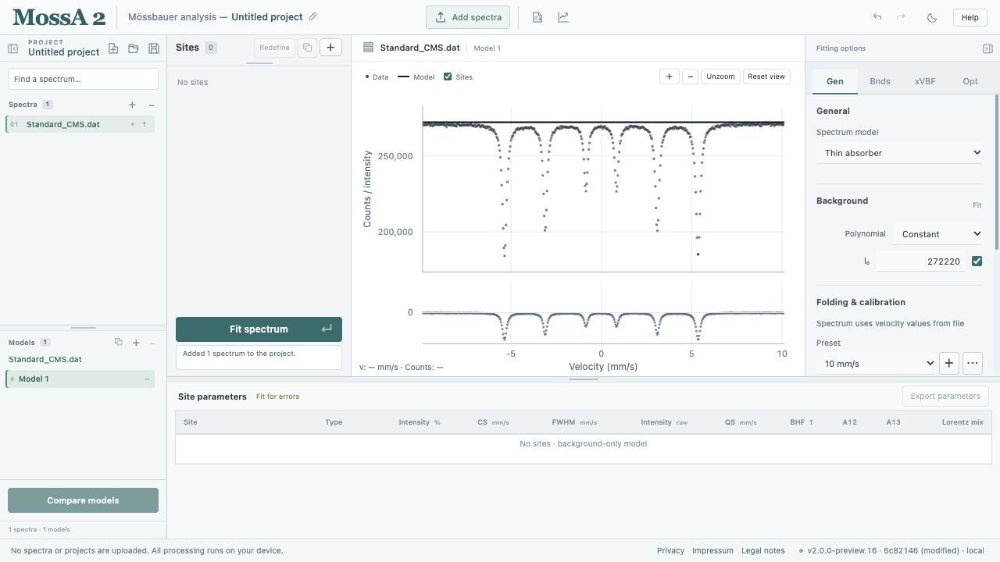
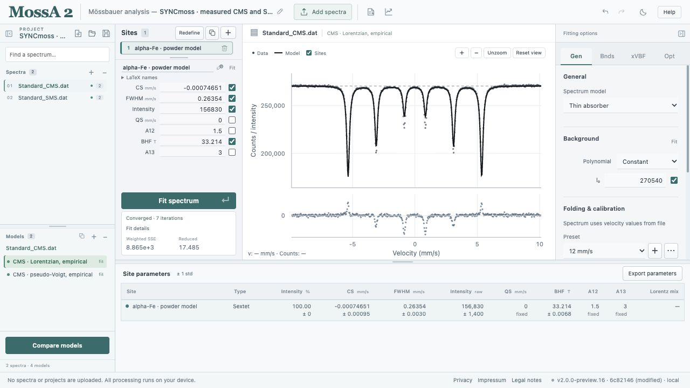
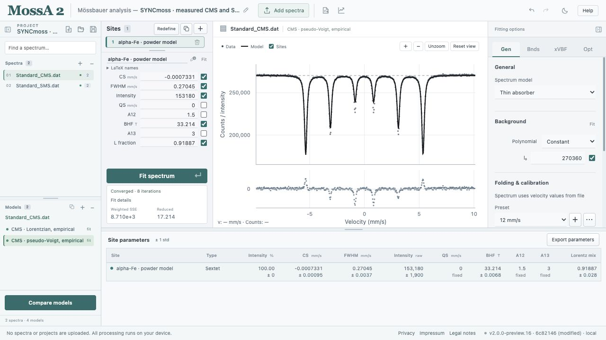
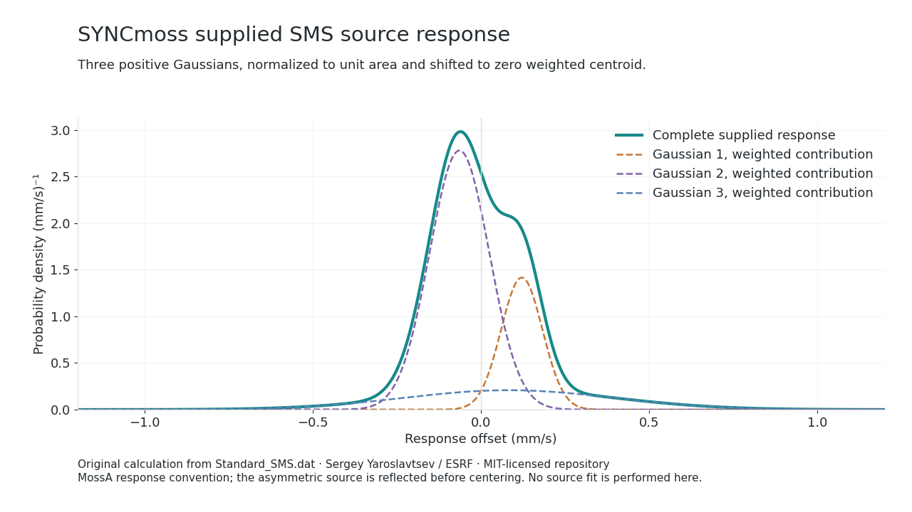
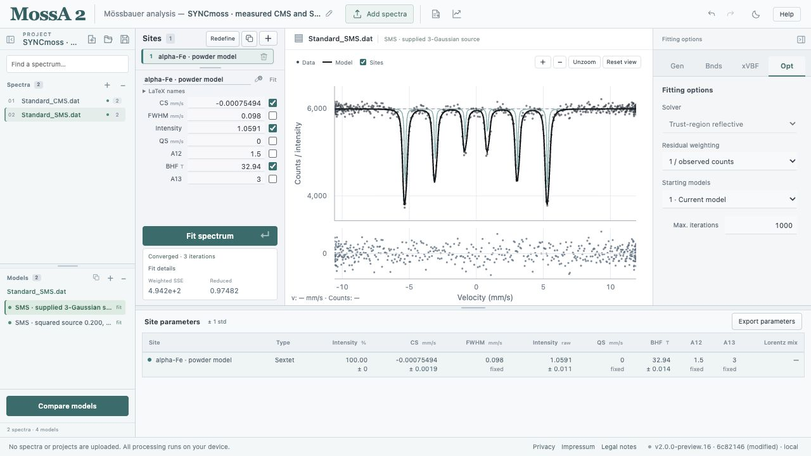
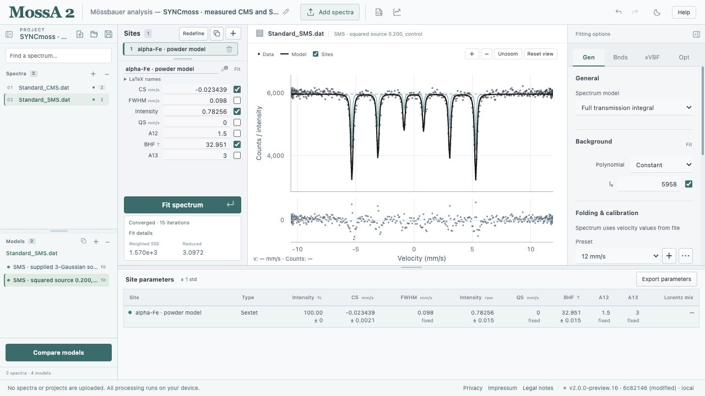
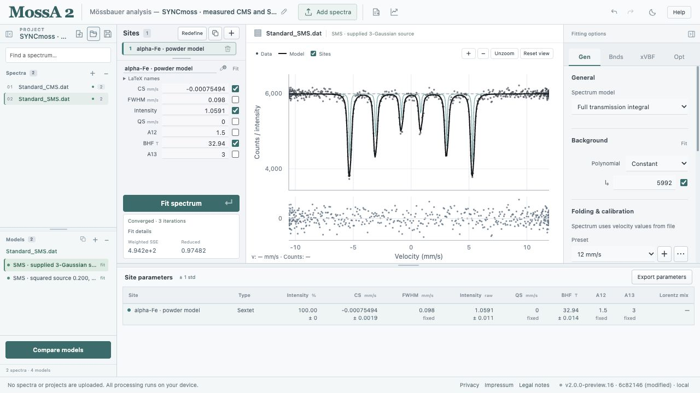
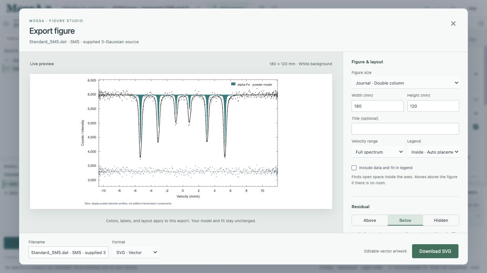

This tutorial uses the measured conventional-source (**CMS**) and synchrotron-source (**SMS**) iron standards bundled with [SYNCmoss](https://github.com/sergey-yaroslavtsev/syncmoss), by Sergey Yaroslavtsev at ESRF. You will import the original data, inspect the limits of simple CMS line fits, use the supplied asymmetric SMS source, and keep alternative models in a worked project. Read [the physics overview](/MossA/manual/foundations/physics/) and [the transmission integral](/MossA/manual/foundations/transmission-integral/) alongside the fitting steps.

:::note[Credit and license]
Original data and supplied source parameters: **Sergey Yaroslavtsev / ESRF**, from repository commit [`b712fbc`](https://github.com/sergey-yaroslavtsev/syncmoss/tree/b712fbc1521004a47409b964b9ab012fe5c5e255). **Copyright (c) European Synchrotron Radiation Facility (ESRF)**. Copies retain the [complete MIT license](/MossA/manual/tutorial-data/syncmoss/UPSTREAM_LICENSE.txt).

Cite Yaroslavtsev, S. (2023), *SYNCmoss software package for fitting Mössbauer spectra measured with a synchrotron Mössbauer source*, **Journal of Synchrotron Radiation 30, 596–604**, [doi:10.1107/S1600577523001686](https://doi.org/10.1107/S1600577523001686).

The text, screenshots, calculated illustrations, and worked fits here are new MossA teaching material. They are not the author's fitted models or reproductions of the paper's figure results, and attribution does not imply endorsement.
:::

## 1. Download the inputs and projects

| Download | What it contains |
| --- | --- |
| <a href="/MossA/manual/tutorial-data/syncmoss/Standard_CMS.dat" download>Standard_CMS.dat</a> | 512 supplied velocity/count pairs, with CMS acquisition/source metadata |
| <a href="/MossA/manual/tutorial-data/syncmoss/Standard_SMS.dat" download>Standard_SMS.dat</a> | 511 supplied velocity/count pairs, with the supplied SMS instrumental profile |
| <a href="/MossA/manual/tutorial-data/syncmoss/Calibration.dat" download>Calibration.dat</a> | The same numerical velocity/count observations as the CMS standard, with a different header |
| <a href="/MossA/manual/tutorial-data/syncmoss/cms-start.mossa" download>CMS starting project</a> | Unfitted empirical sextet, ready to refine |
| <a href="/MossA/manual/tutorial-data/syncmoss/sms-start.mossa" download>SMS starting project</a> | Unfitted transmission sextet with the correctly converted supplied source |
| <a href="/MossA/manual/tutorial-data/syncmoss/syncmoss-worked.mossa" download>Complete worked project</a> | Two measured spectra, four fitted models, and the source settings |

The original files are copied **byte for byte**, including their headers. [Provenance](/MossA/manual/tutorial-data/syncmoss/provenance.json) records their upstream URLs and hashes. [README and attribution](/MossA/manual/tutorial-data/syncmoss/README.txt), [source conversion](/MossA/manual/tutorial-data/syncmoss/source-profile.json), and [complete fit results](/MossA/manual/tutorial-data/syncmoss/fit-results.json) are also available.

`Calibration.dat` is not a third independent measurement and should not be counted as independent validation. These two-column files already contain velocity values; do **not** fold, reverse, or recalibrate them as raw acquisition channels. The SMS velocity spacing is nonuniform; retain the supplied coordinates.

## 2. Inspect a direct data import

Save your current analysis first. Start a new project, then use **Add spectra → Standard_CMS.dat**. Inspect the observed magnetic pattern before adding sites. MossA reads the two numeric columns as velocity and counts, ignoring comment lines for model configuration.

*Original observations on their supplied velocity axis. No channels were folded or normalized.*

:::caution[Data import does not configure the instrument model]
The raw `.dat` import does **not** translate `#@INSexp`, `#@INSint`, or `#@GCMS` into MossA source settings. The original headers remain in the downloadable inputs and provenance record. Use the **SMS starting project** for the converted instrumental response. The simple CMS models below do not reproduce the upstream `#@GCMS` instrument model.
:::

## 3. Fit the CMS standard with one empirical sextet

Open the **CMS starting project**. It supplies one Lorentzian sextet, a constant background, and **Thin absorber** mode. This is a practical observed-line approximation; its width includes unresolved source/sample effects and is not an isolated intrinsic absorber width.

Starting values are CS = 0 mm/s, BHF = 32.94 T, width = 0.30 mm/s, raw intensity = 60,000, and background = 271,000 counts. Fit CS, BHF, width, intensity, and background. Hold QS = 0, A12 = 1.5, and A13 = 3 fixed. Bounds are CS −0.5 to 0.5 mm/s, BHF 25 to 36 T, width 0.05 to 1 mm/s, nonnegative intensity, and background 200,000 to 350,000 counts.

In **Opt**, use **1 / observed counts**, **1 · Current model**, and at most **1,000 iterations**. Choose **Fit spectrum** and inspect the residuals and fit status.

*A converged fit can still be inadequate: its reduced observed-count objective is about 17.49.*

The worked fit gives CS ≈ −0.00075 mm/s, BHF ≈ 33.21396 T, and width ≈ 0.26354 mm/s. These are new model-dependent browser results. The substantial residual structure is a reason to examine the instrumental response, saturation, line ratios, and sample model; it is not evidence for a particular extra phase.

## 4. Compare an empirical pseudo-Voigt

Duplicate the CMS model. Under the selected site's **Site settings**, change the profile to **PseudoVoigt**. Allow **L fraction** to vary between 0 and 1, starting near 0.7, while retaining the other settings. Fit again.

*An extra shape parameter changes the empirical line fit but leaves a poor overall description.*

The example reaches L fraction ≈ 0.91887, width ≈ 0.27045 mm/s, and reduced objective ≈ 17.21. The mixing fraction is a numerical line-shape parameter, not a fraction of two physical sources or iron populations. This remains a thin empirical approximation. Do not present either CMS fit as a complete reproduction of SYNCmoss's instrument treatment or as a certified iron-field calibration.

## 5. Use the supplied SMS source response

Open the **SMS starting project**. It contains the original 511 SMS observations and three Gaussian source components converted from `#@INSexp`. Their shape is supplied by SYNCmoss; it is **not extracted anew from this magnetic standard**. Do not fit a sextet as though it were a known-width singlet reference.

In the pinned upstream convention, a source triple $(a_k,\mu_k,c_k)$ specifies

$$
\sigma_k=a_k^2+0.098/2,\qquad
w_k=2\sqrt{2\ln2}\,\sigma_k,\qquad
p_k=\frac{c_k^2}{\sum_l c_l^2}.
$$

The widths and offsets are in mm/s. SYNCmoss's $T_a(v+u)$ convention requires reflecting the source offsets for MossA's $R(v-u)T_a(u)$ convolution. MossA then removes the response's weighted centroid. The resulting components are:

| Component | Centered response offset (mm/s) | Gaussian FWHM (mm/s) | Area fraction |
| --- | ---: | ---: | ---: |
| 1 | +0.121017 | 0.144551 | 0.218066 |
| 2 | −0.064404 | 0.209067 | 0.618866 |
| 3 | +0.082589 | 0.736492 | 0.163068 |

*Original plot calculated from the supplied source parameters. The weighted mean is zero, which does not require the peak or each component to be centered at zero.*

The original source centroid is +0.00364997 mm/s. An identical-line-position comparison with the pinned SYNCmoss convention adds that value to a MossA absorber center, alongside the necessary magnetic-coefficient and line-intensity conversions. Do not negate already supplied sample velocities or compare BHF labels across programs without accounting for their conventions. The [existing engine-comparison report](https://github.com/CPrescher/MossA/blob/main/validation-data/syncmoss-sms/README.md) records these conversions and their tested scope.

## 6. Fit a scalar SMS transmission model

Keep **Full transmission integral**, the supplied three-Gaussian source, a constant background, and **1 / observed counts**. The starting sextet uses CS = 0 mm/s, BHF = 32.94 T, raw intensity = 1.1, and **intrinsic Lorentzian width fixed at 0.098 mm/s**. QS = 0, A12 = 1.5, and A13 = 3 are fixed. The natural-width choice is an explicit assumption of this worked model.

Fit CS, BHF, intensity, and background, with bounds CS −0.5 to 0.5 mm/s, BHF 25 to 36 T, nonnegative intensity, and background 5,000 to 7,000 counts. Use one current-model start and at most 1,000 iterations.

*The source is held fixed. The fit refines four absorber/continuum parameters.*

The example converges near CS = −0.000755 mm/s, BHF = 32.94024 T, raw intensity = 1.05912, and background = 5,992.04 counts, with reduced objective ≈ **0.97482**. The single component's displayed 100% fraction is a model construction, not an independent purity determination.

*Weighting and fixed assumptions are part of the reported analysis. Approximate fit std does not propagate uncertainty in the supplied source or velocity axis.*

The scalar random-powder model does not establish general polarization, texture, relaxation, or combined-Hamiltonian behavior. Agreement with this spectrum does not establish that its single component is the unique physical description, or reproduce the more detailed models in the 2023 paper.

## 7. Deliberately replace the source

Duplicate the fitted SMS model. In **Gen → Source profile**, choose **Use simple source**, enable **Lorentzian-squared source**, and enter **0.200 mm/s**. Keep the absorber width fixed and refit the same four parameters.

*The deliberately approximated source leaves a larger objective and shifts the fitted center.*

The example reaches reduced objective ≈ **3.09719**, CS ≈ −0.02344 mm/s, and BHF ≈ 32.95147 T. The squared-source number is the [legacy width parameter](/MossA/manual/foundations/line-shapes/#lorentzian-squared-has-a-legacy-width-convention), whose actual FWHM is about 0.12872 mm/s. It is not an equal-FWHM replacement for the asymmetric mixture.

This is a controlled illustration with an arbitrarily fixed approximate source, **not** an optimized alternative source calibration or a formal statistical preference test. Use the model tabs to inspect it; the simulation-comparison tool requires matching fixed source assumptions and rejects this comparison. Extra absorber sites should not be used automatically to compensate for an incorrect instrumental function.

## 8. Inspect, save, and report the worked examples

Open the **complete worked project** to switch between the two spectra and all four saved fits. Each model retains its observations, fit settings, and results; switching models does not fit again.

*The original source parameters and license are retained in project provenance and companion downloads. No duplicate CMS measurement is added for Calibration.dat.*

Use **Save project**, **Export parameters**, and **Export graph** to retain the analysis. Keep the downloaded `provenance.json` and `UPSTREAM_LICENSE.txt` alongside any resaved project so its original attribution and acquisition headers stay available. In the figure studio, keep the residuals and identify the fitted source/model in the caption.

*A publication-style figure remains on a white page inside either app theme.*

Report the original SYNCmoss attribution, pinned input files, supplied velocity axis, source conversion, fixed intrinsic width, magnetic convention, model constraints, weighting, and fit limitations. State explicitly that these are **new MossA fits**. The [full fit outputs](/MossA/manual/tutorial-data/syncmoss/fit-results.json) and [provenance record](/MossA/manual/tutorial-data/syncmoss/provenance.json) allow the worked values to be checked without treating screenshots as numerical reference data.
